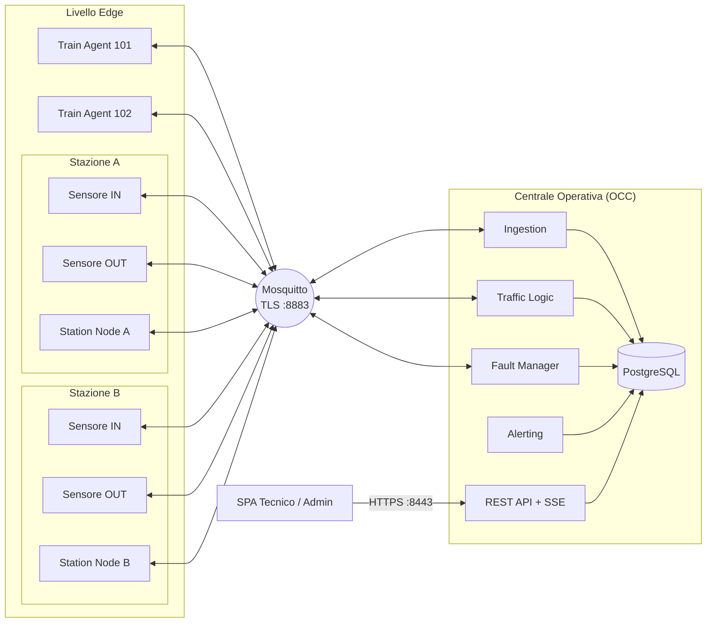
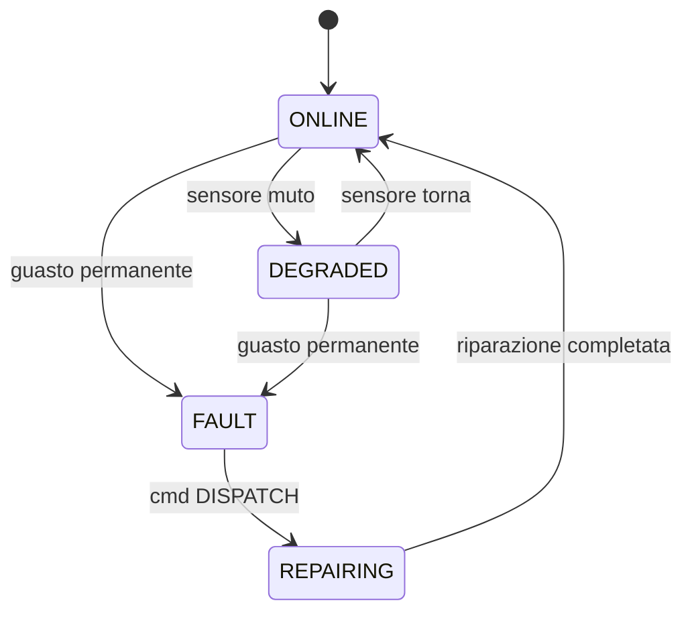
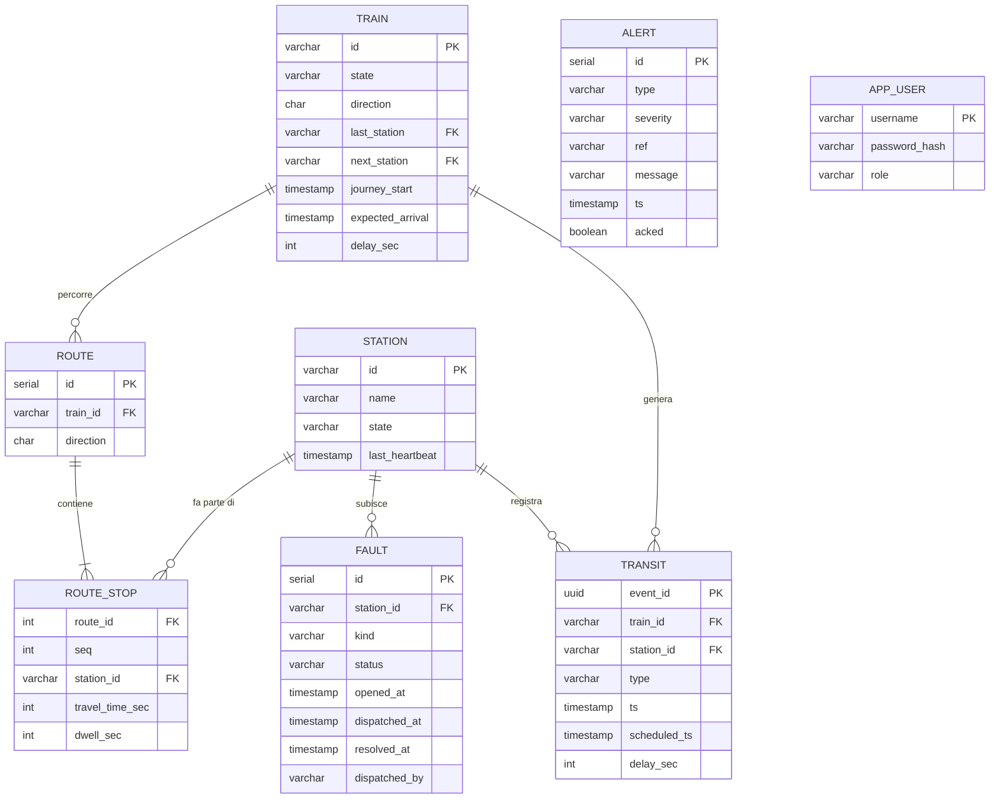
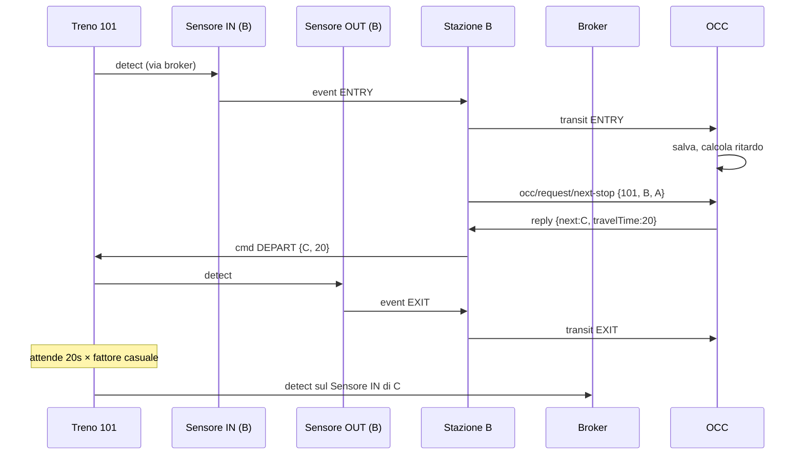
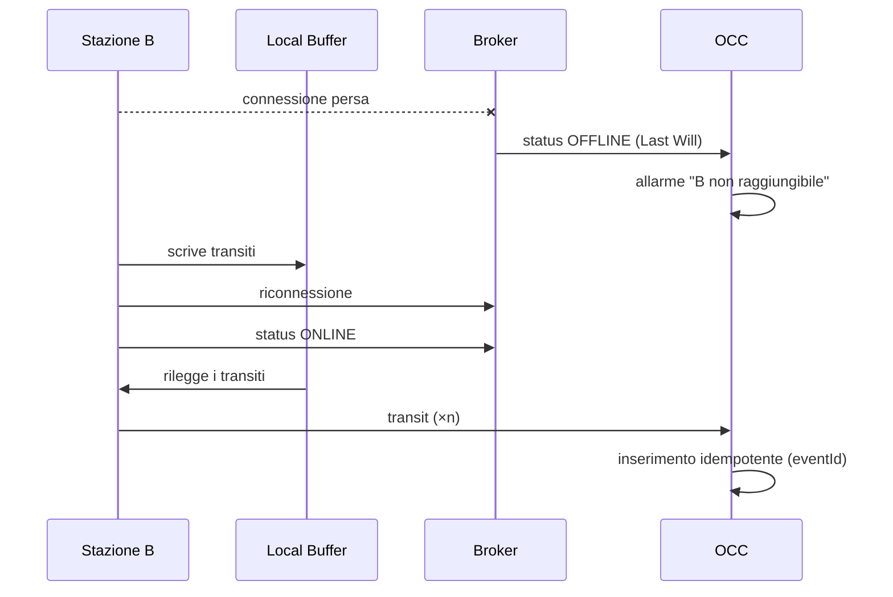
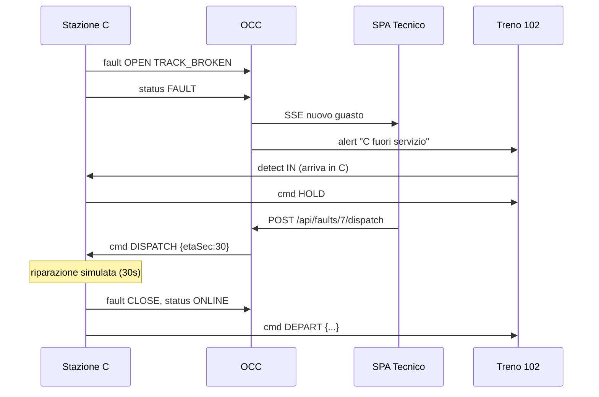
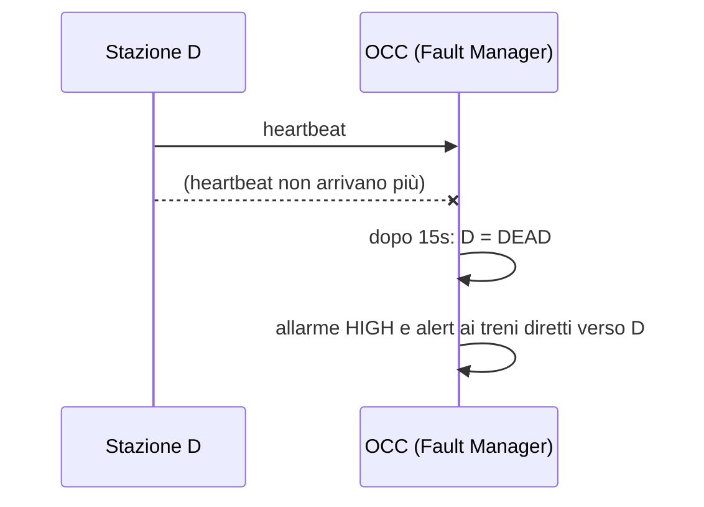

# Architettura del sistema

Questo documento descrive come abbiamo organizzato il sistema di monitoraggio del traffico ferroviario: le tecnologie, i servizi, i topic MQTT, il database, le API REST e i flussi principali. Lo useremo come base per i capitoli 2, 3 e 4 della relazione.

## Requisiti del progetto

Funzioni ed eventi richiesti dal testo del progetto, con il servizio che se ne occupa.

| Requisito | Servizio |
|---|---|
| Rilevare ingresso e uscita di un treno in stazione e il suo numero | SensorAgent, StationNode |
| Un treno può partire da una stazione senza esserci entrato (origine) o entrarci senza uscirne (capolinea) | StationNode, TrainAgent |
| Disconnessione temporanea dalla centrale: i dati non vanno persi e vengono reinviati | StationNode (buffer locale, QoS 1) |
| Guasto permanente (binario rotto, treno deragliato): segnalato subito alla centrale | StationNode |
| Durante il guasto ogni treno che entra viene avvisato e non riparte fino alla riparazione | StationNode, TrainAgent |
| Il tecnico invia gli operatori a riparare una stazione guasta | SPA, OccServer |
| Heartbeat tra sensori e stazione: se un sensore tace, la stazione si segnala guasta alla centrale | SensorAgent, StationNode |
| Heartbeat tra stazione e centrale: se una stazione tace, la centrale la considera guasta | StationNode, OccServer |
| Ogni treno è un processo separato che simula il viaggio e riceve avvisi di guasti e ritardi | TrainAgent |
| La prossima stazione viene chiesta alla centrale, che la legge dal database | StationNode, OccServer |
| Calcolo dei ritardi e previsione degli arrivi | OccServer |
| Database con stato della linea, storico dei transiti, guasti e tratte di andata e ritorno di ogni treno | OccServer |
| Allarme automatico se un treno resta fermo troppo tempo tra due stazioni | OccServer |
| Tecnico: vede traffico e tratte, i treni attesi in una stazione, invia operatori | SPA, API REST |
| Amministratore: vede traffico e tratte, aggiunge, modifica ed elimina tratte, sopprime treni fermi | SPA, API REST |
| Comunicazione su TLS | Mosquitto, OccServer |

## 1. Tecnologie

| Ambito | Scelta | Motivo |
|---|---|---|
| Linguaggio | Java 21 | Il testo del progetto parla di JDBC e usiamo lo stesso linguaggio per tutti i servizi. |
| Build | Maven, progetto multi-modulo | Un modulo per ogni servizio e un modulo `common` con il codice condiviso. |
| Client MQTT | Eclipse Paho (`org.eclipse.paho.client.mqttv3`) | Supporta TLS, QoS, sessioni persistenti e Last Will. |
| Broker | Mosquitto | È leggero e si configura facilmente con TLS e ACL. |
| Server REST | Javalin | Framework piccolo, poche righe per definire un endpoint. In alternativa si può usare Spark Java. |
| JSON | Jackson | Serve sia per i messaggi MQTT sia per le risposte REST. |
| Database | PostgreSQL con JDBC | |
| Password | BCrypt (libreria jBCrypt) | Salviamo sul server solo l'hash della password. |
| Interfaccia web | SPA in HTML e JavaScript, senza framework | La pagina chiama le API con `fetch` e riceve gli aggiornamenti con Server-Sent Events. |
| Avvio | Docker Compose per Mosquitto e Postgres | I servizi Java girano come processi separati. |

Rispetto alle varianti ammesse scegliamo la 1 (SPA), la 2 (login e password salvati sul server) e la 3 (database con JDBC). Nessuna delle tre comporta penalità. Implementiamo TLS sia su MQTT sia su HTTP, e ogni stazione è un processo separato.

## 2. Vista d'insieme



Sensori, stazioni, treni e centrale non si parlano direttamente: ognuno pubblica e riceve messaggi sul broker. L'unica comunicazione fuori da MQTT è quella tra il browser e la centrale, in HTTPS.

Durante la demo saranno attivi questi processi:

| Processo | Istanze | Modulo Maven |
|---|---|---|
| `SensorAgent` | 2 per stazione (ingresso e uscita) | `sensor` |
| `StationNode` | 1 per stazione | `station` |
| `TrainAgent` | 1 per treno | `train` |
| `OccServer` | 1 | `occ` |
| Mosquitto, Postgres | 1 ciascuno | Docker |

Lo script `launch.sh` compila il progetto e avvia tutti i processi. L'elenco delle stazioni e dei treni da avviare è scritto all'inizio dello script.

## 3. Servizi

Per ogni servizio indichiamo cosa riceve (IN), cosa produce (OUT) e quali thread usa. Nella relazione queste informazioni diventeranno le interfacce degli esagoni.

### 3.1 SensorAgent

Simula un sensore fisico, ad esempio una fotocellula o un lettore RFID. Ogni stazione ha un sensore in ingresso e uno in uscita.

IN:
- `rail/station/{S}/sensor/{sensorId}/detect`: il treno che passa davanti al sensore.

OUT:
- `rail/station/{S}/sensor/{sensorId}/event`: la rilevazione inoltrata alla stazione.
- `rail/station/{S}/sensor/{sensorId}/heartbeat`: un messaggio ogni 2 secondi.

Quando riceve un `detect`, il sensore controlla che il messaggio sia valido, aggiunge l'ora e un identificativo univoco (`eventId`, un UUID) e lo inoltra alla stazione. Per simulare un guasto basta mandargli il comando `kill` sul topic `.../sim`: da quel momento smette di inviare heartbeat e rilevazioni.

Thread: la callback di Paho e uno `ScheduledExecutor` per l'heartbeat.

### 3.2 StationNode

Gestisce una stazione. C'è un processo per ogni stazione.

IN:
- `rail/station/{S}/sensor/+/event`: rilevazioni dei sensori.
- `rail/station/{S}/sensor/+/heartbeat`: heartbeat dei sensori.
- `rail/station/{S}/ready`: un treno è pronto a partire da questa stazione, che è la sua stazione di origine.
- `rail/station/{S}/reply/next-stop`: risposta della centrale con la prossima fermata.
- `rail/station/{S}/cmd`: comandi della centrale (operatori inviati, soppressione di un treno).
- `rail/station/{S}/sim`: comandi per simulare un guasto durante la demo.

OUT:
- `rail/station/{S}/transit`: ingresso o uscita di un treno (QoS 1).
- `rail/station/{S}/heartbeat`: un messaggio ogni 5 secondi (QoS 0).
- `rail/station/{S}/status`: stato della stazione, cioè `ONLINE`, `DEGRADED`, `FAULT` o `OFFLINE`. Il messaggio è retained e `OFFLINE` è impostato come Last Will.
- `rail/station/{S}/fault`: apertura e chiusura di un guasto (QoS 1).
- `rail/occ/request/next-stop`: richiesta della prossima fermata di un treno.
- `rail/train/{id}/cmd`: ordini al treno (`DEPART`, `HOLD`, `SUPPRESS`).

Dentro la stazione ci sono quattro parti:
- il controller, che tiene l'elenco dei treni presenti e lo stato della stazione;
- il buffer locale, un file `buffer-{S}.jsonl` dove scriviamo i transiti finché il broker non ne conferma la ricezione; quando la connessione torna, i transiti rimasti vengono reinviati;
- il generatore di heartbeat verso la centrale;
- il watchdog dei sensori: se un sensore non manda heartbeat per 6 secondi (tre intervalli), la stazione passa in `DEGRADED` e lo comunica alla centrale.

Thread: la callback di Paho, uno scheduler per heartbeat e watchdog, un thread che svuota il buffer dopo una riconnessione.

Stati della stazione:



Negli stati `FAULT` e `REPAIRING` la stazione risponde `HOLD` a ogni treno che entra, e il treno resta fermo. Quando la riparazione finisce, la stazione manda `DEPART` ai treni trattenuti.

### 3.3 TrainAgent

Ogni treno è un processo che simula il proprio viaggio. Il suo stato contiene il numero del convoglio, la direzione (A per andata, R per ritorno), la stazione precedente, la prossima stazione e una fase tra `RUNNING`, `IN_STATION`, `HELD`, `SUPPRESSED` e `ARRIVED`.

IN:
- `rail/train/{id}/cmd`: ordini della stazione.
- `rail/train/{id}/alert` e `rail/alerts`: avvisi della centrale su guasti e ritardi.

OUT:
- `rail/station/{S}/ready`: all'avvio il treno avvisa la stazione di origine che è pronto a partire.
- `rail/station/{S}/sensor/{IN|OUT}/detect`: il treno si presenta ai sensori.

Il movimento segue un semplice motore a eventi discreti:
1. il treno riceve `DEPART` con la prossima stazione e il tempo di percorrenza;
2. pubblica `detect` sul sensore di uscita della stazione in cui si trova;
3. programma l'arrivo dopo il tempo di percorrenza moltiplicato per un fattore casuale tra 0,9 e 1,3, per simulare rallentamenti;
4. all'arrivo pubblica `detect` sul sensore di ingresso della nuova stazione e aspetta il prossimo ordine.

Per provare l'allarme "treno fermo tra due stazioni" il treno accetta il comando `sim stop`, che lo blocca a metà percorso.

Thread: la callback di Paho e uno `ScheduledExecutor` per il motore.

### 3.4 OccServer

La centrale è un unico processo, diviso in package. Il testo permette un server monolitico; nella relazione disegneremo comunque un esagono per ogni modulo.

| Modulo | IN | OUT | Compito |
|---|---|---|---|
| Ingestion | `rail/station/+/transit` | DB, eventi interni | Controlla il messaggio, scarta i duplicati, aggiorna la posizione del treno e calcola il ritardo. |
| Traffic Logic | `rail/occ/request/next-stop` | `rail/station/{S}/reply/next-stop` | Legge la tratta dal database e risponde con la prossima stazione e il tempo di percorrenza, oppure con `null` se il treno è al capolinea. |
| Fault Manager | `rail/station/+/heartbeat`, `+/status`, `+/fault` | `rail/station/{S}/cmd`, DB | Controlla gli heartbeat delle stazioni, apre e chiude i guasti, invia `DISPATCH` quando il tecnico manda gli operatori. |
| Alerting | eventi interni, timer | `rail/alerts`, `rail/train/{id}/alert`, DB | Genera gli allarmi: treno fermo tra due stazioni, stazione non raggiungibile, ritardo sopra soglia. Avvisa i treni diretti verso una stazione guasta. |
| REST API | HTTPS `/api/*` | DB, Fault Manager | Espone gli endpoint per la SPA e lo stream `/api/stream` per gli aggiornamenti in tempo reale. |
| Persistence | | JDBC | Un DAO per ogni tabella. |

Thread: la callback di Paho passa ogni messaggio a un executor, così non si blocca durante le query. Javalin usa il proprio pool di thread per le richieste HTTP e uno scheduler esegue i controlli periodici. I moduli si scambiano eventi tramite una piccola classe publish/subscribe in memoria e condividono il pool di connessioni al database.

## 4. Topic MQTT

Tutti i topic iniziano con `rail/`. I messaggi sono in JSON e contengono sempre il campo `ts` (data e ora in formato ISO-8601); i messaggi che devono arrivare una sola volta in centrale hanno anche un `eventId`.

| Topic | Mittente | Destinatario | QoS | Retained | Esempio |
|---|---|---|---|---|---|
| `station/{S}/sensor/{sid}/detect` | Treno | Sensore | 1 | no | `{"trainId":"101","ts":…}` |
| `station/{S}/sensor/{sid}/event` | Sensore | Stazione | 1 | no | `{"eventId":…,"sensor":"IN","trainId":"101","ts":…}` |
| `station/{S}/sensor/{sid}/heartbeat` | Sensore | Stazione | 0 | no | `{"ts":…}` |
| `station/{S}/ready` | Treno | Stazione | 1 | no | `{"trainId":"101","dir":"A","ts":…}` |
| `station/{S}/transit` | Stazione | OCC | 1 | no | `{"eventId":…,"trainId":"101","type":"ENTRY","dir":"A","ts":…}` |
| `station/{S}/heartbeat` | Stazione | OCC | 0 | no | `{"ts":…,"sensors":{"IN":"OK","OUT":"OK"}}` |
| `station/{S}/status` | Stazione | OCC | 1 | sì (Last Will `OFFLINE`) | `{"state":"ONLINE"}` |
| `station/{S}/fault` | Stazione | OCC | 1 | no | `{"faultId":…,"kind":"TRACK_BROKEN","action":"OPEN"}` |
| `occ/request/next-stop` | Stazione | OCC | 1 | no | `{"reqId":…,"stationId":"B","trainId":"101","dir":"A"}` |
| `station/{S}/reply/next-stop` | OCC | Stazione | 1 | no | `{"reqId":…,"next":"C","travelTime":20}` |
| `station/{S}/cmd` | OCC | Stazione | 1 | no | `{"cmd":"DISPATCH","faultId":…,"etaSec":30}` |
| `station/{S}/sim` | Script di demo | Stazione | 1 | no | `{"inject":"TRACK_BROKEN"}` |
| `train/{id}/cmd` | Stazione | Treno | 1 | no | `{"cmd":"DEPART","next":"C","travelTime":20}` |
| `train/{id}/alert` | OCC | Treno | 1 | no | `{"type":"DELAY","msg":…}` |
| `alerts` | OCC | Tutti | 1 | no | `{"severity":"HIGH","msg":"Stazione C fuori servizio"}` |

Il campo `reqId` serve a collegare una risposta alla sua richiesta, perché MQTT non ha un meccanismo di richiesta e risposta.

Mosquitto accetta connessioni solo sulla porta 8883 in TLS, con certificati firmati da una CA creata per il progetto. Ogni servizio ha un proprio utente e una password, e un file ACL stabilisce su quali topic può scrivere. Ad esempio, l'utente `station-B` può pubblicare solo su `rail/station/B/#`, `rail/occ/request/#` e `rail/train/+/cmd`.

## 5. Gestione dei guasti

| Situazione | Come la gestiamo |
|---|---|
| La stazione perde la connessione al broker | Usiamo QoS 1 con sessione persistente (`cleanSession=false`). In più la stazione scrive ogni transito sul buffer locale e lo cancella solo quando Paho ne conferma la consegna. |
| La centrale riceve lo stesso messaggio due volte | Con QoS 1 può succedere. Nel database `eventId` è chiave primaria e l'inserimento usa `ON CONFLICT DO NOTHING`, quindi il duplicato viene ignorato. |
| Una stazione si ferma | Se cade la connessione, il broker pubblica subito il Last Will `OFFLINE`. Se il processo è bloccato ma ancora connesso, la centrale se ne accorge dopo tre heartbeat mancati (15 secondi). |
| Un sensore si ferma | Il watchdog della stazione lo rileva e la stazione comunica lo stato `DEGRADED`. |
| Un treno resta fermo tra due stazioni | Ogni 5 secondi l'Alerting controlla i treni in viaggio. Se è passato più di una volta e mezzo il tempo di percorrenza previsto e non è arrivato l'ingresso nella stazione successiva, genera un allarme. |
| La centrale si riavvia | Lo stato è salvato nel database, e i messaggi `status` retained permettono di sapere subito quali stazioni sono attive. |

## 6. Database



Ogni tratta (`ROUTE`) ha un elenco ordinato di fermate (`ROUTE_STOP`) con il tempo di percorrenza dalla fermata precedente e il tempo di sosta.

Nella simulazione i treni partono quando li avviamo, non a un orario fisso. Per questo l'orario previsto di ogni fermata si calcola a partire dalla partenza effettiva dalla stazione di origine, salvata in `journey_start`. Da questi dati calcoliamo:
- l'orario previsto di arrivo a una fermata: `journey_start` più la somma dei tempi di percorrenza e delle soste delle fermate precedenti; per la partenza si aggiunge anche la sosta nella fermata stessa;
- il ritardo: la differenza tra l'orario reale del transito e quello previsto, negativa se il treno è in anticipo; viene salvato sia nel transito sia nel treno;
- l'arrivo previsto alla prossima stazione (`expected_arrival`): l'ora reale di partenza più il tempo di percorrenza. Un treno partito in ritardo ha quindi anche un arrivo previsto più tardi.

Esempio con la tratta A, B, C (20 s da A a B, sosta di 5 s in B, 25 s da B a C): se il treno lascia A alle 10:00:00, l'arrivo previsto in B è alle 10:00:20, la partenza da B alle 10:00:25 e l'arrivo in C alle 10:00:50. Il calcolo è nella classe `Schedule`, verificata dal test `ScheduleTest`.

## 7. API REST

Le API sono disponibili solo in HTTPS. Dopo il login il server crea una sessione con cookie. I ruoli sono due: `TECH` (tecnico) e `ADMIN` (amministratore).

| Metodo | Percorso | Ruolo | Descrizione |
|---|---|---|---|
| POST | `/api/login`, `/api/logout` | tutti | Accesso e uscita |
| GET | `/api/stations` | TECH, ADMIN | Stato di tutte le stazioni |
| GET | `/api/stations/{id}/expected` | TECH, ADMIN | Treni attesi in ingresso e in uscita, con orario stimato |
| GET | `/api/trains`, `/api/trains/{id}` | TECH, ADMIN | Posizione, stato e ritardo dei treni |
| GET | `/api/routes`, `/api/routes/{id}` | TECH, ADMIN | Tratte e fermate |
| POST, PUT, DELETE | `/api/routes[/{id}]` | ADMIN | Creazione, modifica ed eliminazione delle tratte |
| POST | `/api/trains/{id}/suppress` | ADMIN | Soppressione di un treno fermo in stazione |
| GET | `/api/faults?status=OPEN` | TECH, ADMIN | Guasti aperti |
| POST | `/api/faults/{id}/dispatch` | TECH | Invio degli operatori |
| GET | `/api/alerts` | TECH, ADMIN | Elenco degli allarmi |
| POST | `/api/alerts/{id}/ack` | TECH, ADMIN | Presa visione di un allarme |
| GET | `/api/stream` | TECH, ADMIN | Aggiornamenti in tempo reale (Server-Sent Events) |

La SPA ha una pagina principale con la linea ferroviaria, dove ogni stazione è colorata in base al suo stato e i treni compaiono nella loro posizione. Sotto ci sono la tabella dei treni con il ritardo, l'elenco degli allarmi e l'elenco dei guasti con il pulsante "Invia operatori", visibile solo al tecnico. L'amministratore ha in più una pagina per modificare le tratte.

## 8. Diagrammi di sequenza

### 8.1 Transito di un treno



Quando un treno entra in stazione, la stazione chiede alla centrale qual è la prossima fermata. In questo modo, se l'amministratore modifica una tratta, il cambiamento vale già dalla fermata successiva.

### 8.2 Disconnessione temporanea di una stazione



### 8.3 Guasto permanente e riparazione



### 8.4 Stazione bloccata ma ancora connessa



## 9. Struttura del repository

```
PissirShared/
├── pom.xml                 (parent)
├── common/                 messaggi (record Java), nomi dei topic, client MQTT
├── sensor/                 SensorAgent
├── station/                StationNode
├── train/                  TrainAgent
├── occ/                    OccServer, ingestion/, traffic/, fault/, alerting/, api/, db/
│   └── src/main/resources/public/   SPA (index.html, app.js, style.css)
├── infra/
│   ├── docker-compose.yml  mosquitto + postgres
│   ├── mosquitto/          mosquitto.conf, acl, passwd
│   ├── certs/              script per generare CA e certificati
│   └── db/schema.sql, seed.sql
├── launch.sh               avvia tutti i processi della demo
├── stop.sh
└── docs/
```

## 10. Piano di lavoro

1. Infrastruttura: docker-compose, Mosquitto inizialmente senza TLS, schema del database, modulo `common`.
2. Primo percorso funzionante: sensori, stazione e treno su una linea A, B, C con tratte fisse. Controlliamo i messaggi con `mosquitto_sub -t 'rail/#' -v`.
3. Centrale: ingestion e richiesta della prossima fermata, con salvataggio su database.
4. Affidabilità: heartbeat, watchdog, Last Will, buffer locale, eliminazione dei duplicati.
5. Guasti: simulazione, blocco dei treni, invio degli operatori, ripristino.
6. API REST e SPA: login, pagina principale, aggiornamenti in tempo reale, modifica delle tratte.
7. TLS su Mosquitto e HTTPS, ACL.
8. Validazione: test unitari sul calcolo dei ritardi, sull'eliminazione dei duplicati e sugli stati della stazione, più uno scenario di prova per ogni diagramma della sezione 8.

## 11. Corrispondenza con la relazione

| Capitolo della relazione | Dove trovare il materiale |
|---|---|
| 1. Specifiche funzionali | Testo del progetto e sezione 3 |
| 2. Analisi delle tecnologie | Sezione 1, più il confronto con le alternative: polling REST, WebSocket, AMQP con RabbitMQ, CoAP |
| 3. Scelta dell'approccio | Motivi per usare un broker: i componenti sono disaccoppiati, le stazioni aprono solo connessioni in uscita (quindi funzionano dietro NAT senza configurare il router), QoS e Last Will sono già nel protocollo |
| 4. Architettura | Sezioni 2, 3, 4 e 8 |
| 5. Implementazione | Sezioni 6 e 7, più i diagrammi UML delle classi quando il codice sarà scritto |
| 6. Validazione | Sezione 10, punto 8 |
