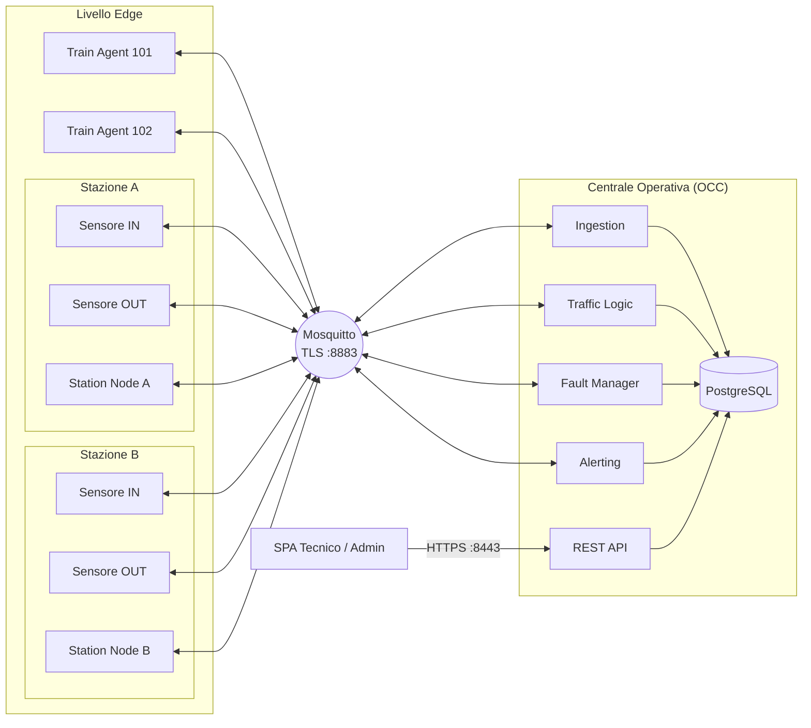
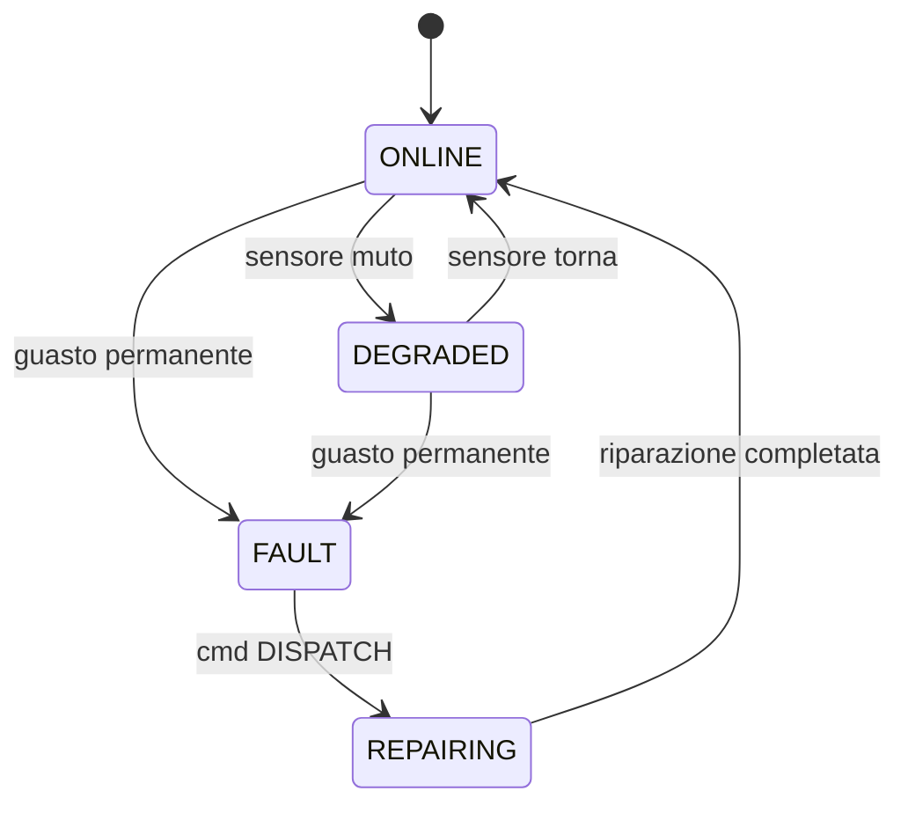
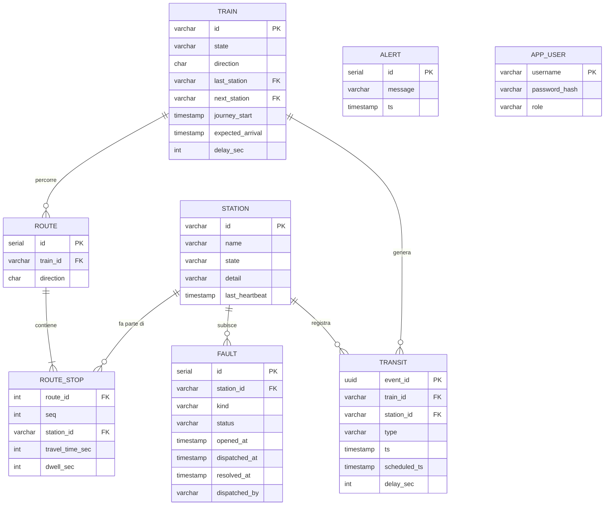
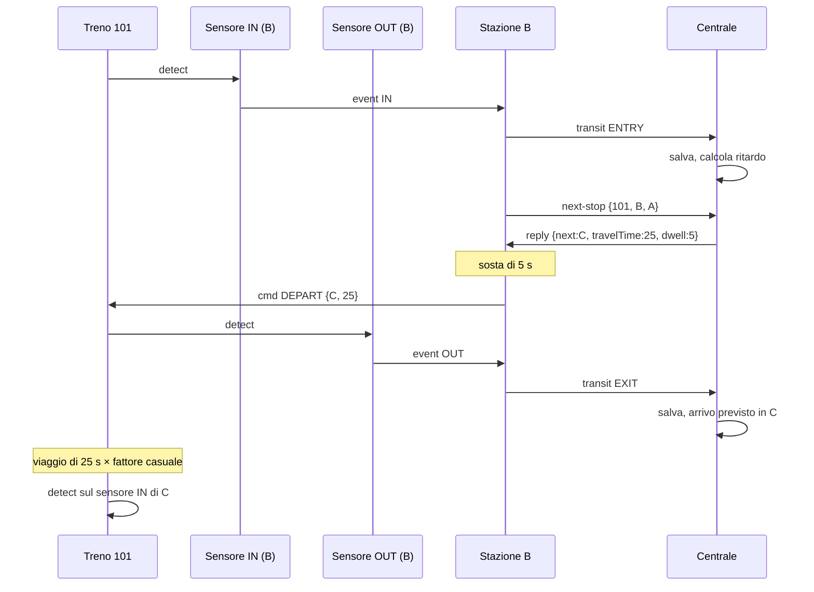
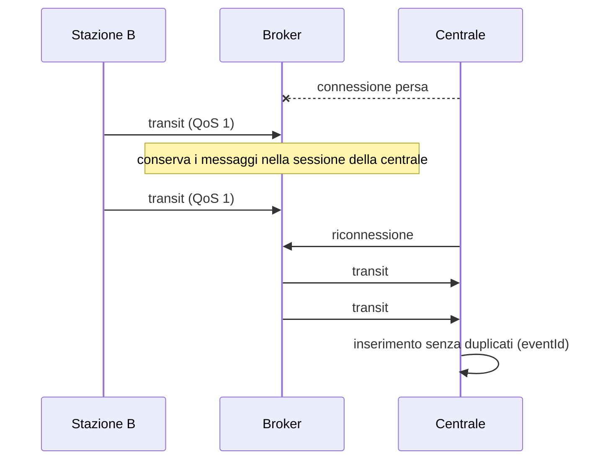
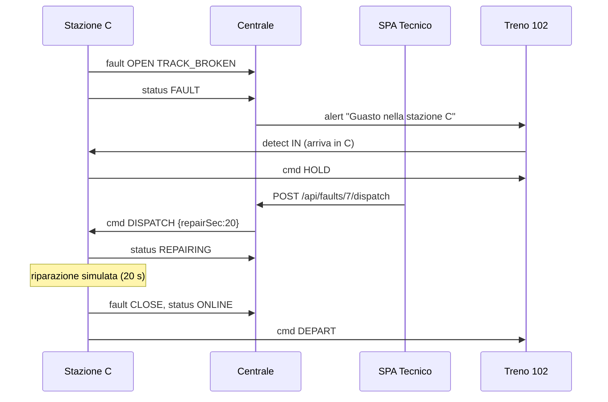
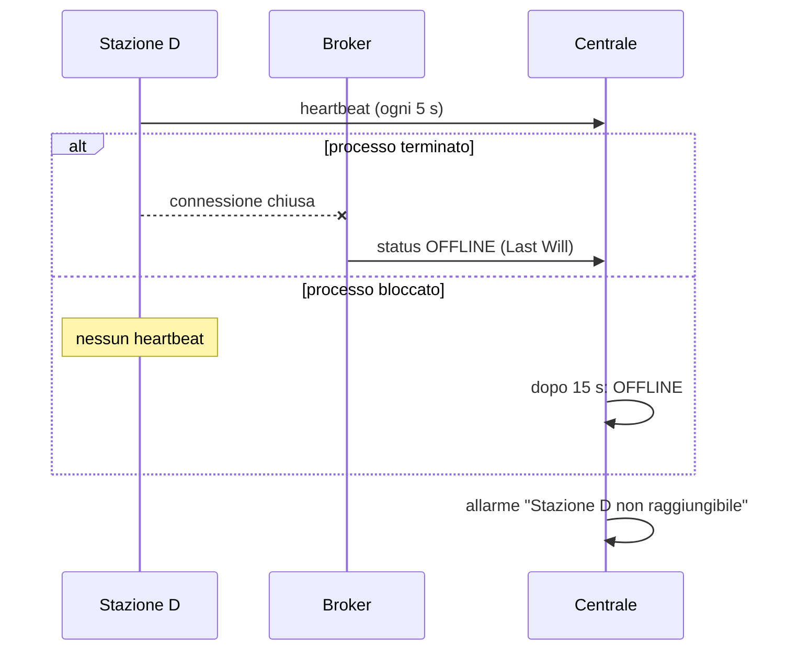

# Architettura del sistema

Questo documento descrive come è organizzato il sistema di monitoraggio del traffico ferroviario: le tecnologie, i servizi, i topic MQTT, il database, le API REST e i flussi principali. Le prove eseguite sono in [validazione.md](validazione.md).

## Requisiti del progetto

Funzioni ed eventi richiesti dal testo del progetto, con il servizio che se ne occupa.

| Requisito | Servizio |
|---|---|
| Rilevare ingresso e uscita di un treno in stazione e il suo numero | SensorAgent, StationNode |
| Un treno può partire da una stazione senza esserci entrato (origine) o entrarci senza uscirne (capolinea) | StationNode, TrainAgent |
| Disconnessione temporanea: i dati non vanno persi e vengono recapitati | Broker (QoS 1, sessione persistente) |
| Guasto permanente (binario rotto, treno deragliato): segnalato subito alla centrale | StationNode |
| Durante il guasto ogni treno che entra viene avvisato e non riparte fino alla riparazione | StationNode, TrainAgent |
| Il tecnico invia gli operatori a riparare una stazione guasta | SPA, FaultManager |
| Heartbeat tra sensori e stazione: se un sensore tace, la stazione lo segnala alla centrale | SensorAgent, StationNode |
| Heartbeat tra stazione e centrale: se una stazione tace, la centrale la considera guasta | StationNode, FaultManager |
| Ogni treno è un processo separato che simula il viaggio e riceve avvisi di guasti e ritardi | TrainAgent |
| La prossima stazione viene chiesta alla centrale, che la legge dal database | StationNode, TrafficLogic |
| Calcolo dei ritardi e previsione degli arrivi | Ingestion |
| Database con stato della linea, storico dei transiti, guasti e tratte di andata e ritorno di ogni treno | PostgreSQL |
| Allarme automatico se un treno resta fermo troppo tempo tra due stazioni | OverdueTrainMonitor |
| Tecnico: vede traffico e tratte, i treni attesi in una stazione, invia gli operatori | SPA, RestApi |
| Amministratore: vede traffico e tratte, aggiunge, modifica ed elimina tratte, sopprime i treni fermi | SPA, RestApi |
| Comunicazione su TLS | Mosquitto, RestApi |

## 1. Tecnologie

| Ambito | Scelta | Motivo |
|---|---|---|
| Linguaggio | Java 21 | Il testo del progetto parla di JDBC; usiamo lo stesso linguaggio per tutti i servizi. |
| Build | Maven, progetto multi-modulo | Scarica le librerie e crea un jar avviabile per ogni servizio. |
| Client MQTT | Eclipse Paho | Supporta TLS, QoS, sessioni persistenti e Last Will. |
| Broker | Mosquitto | È leggero e si configura facilmente con TLS, password e permessi sui topic. |
| Server REST | Javalin, con il plugin SSL per HTTPS | Poche righe per definire un endpoint. |
| JSON | Jackson | Serve sia per i messaggi MQTT sia per le risposte REST. |
| Database | PostgreSQL con JDBC | |
| Password | BCrypt (libreria jBCrypt) | Sul server salviamo solo l'hash della password. |
| Interfaccia web | SPA in HTML e JavaScript, senza framework | La pagina chiama le API con `fetch` e rilegge i dati ogni 2 secondi. |
| Avvio | Docker Compose | Un solo comando avvia broker, database e un container per ogni sensore, stazione, treno e per la centrale. |

Rispetto alle varianti ammesse scegliamo la 1 (SPA), la 2 (login e password salvati sul server) e la 3 (database con JDBC). Nessuna delle tre comporta penalità. Usiamo TLS sia su MQTT sia su HTTP, e ogni stazione è un processo separato.

## 2. Vista d'insieme



Sensori, stazioni, treni e centrale non si parlano direttamente: ognuno pubblica e riceve messaggi sul broker. L'unica comunicazione fuori da MQTT è quella tra il browser e la centrale, in HTTPS.

Durante la demo sono attivi questi processi:

| Processo | Istanze | Modulo Maven |
|---|---|---|
| `SensorAgent` | 2 per stazione (ingresso e uscita) | `sensor` |
| `StationNode` | 1 per stazione | `station` |
| `TrainAgent` | 1 per treno | `train` |
| `OccServer` | 1 | `occ` |
| Mosquitto, Postgres | 1 ciascuno | |

`docker compose up` avvia ogni processo in un container separato, tutti a partire dalla stessa immagine con i jar dei servizi (`Dockerfile`). Al primo avvio un container crea anche i certificati. Durante lo sviluppo lo script `launch.sh` avvia gli stessi processi direttamente sul computer.

## 3. Servizi

Per ogni servizio indichiamo cosa riceve (IN), cosa produce (OUT) e quali thread usa. Tutti usano la classe `Mqtt` del modulo `common`, che gestisce i messaggi ricevuti su un thread dedicato, uno alla volta e nell'ordine di arrivo.

### 3.1 SensorAgent

Simula un sensore fisico, ad esempio una fotocellula o un lettore RFID. Ogni stazione ha un sensore in ingresso (IN) e uno in uscita (OUT).

IN:
- `rail/station/{S}/sensor/{sid}/detect`: il treno passa davanti al sensore.
- `rail/station/{S}/sensor/{sid}/sim`: simulazione di un guasto (`kill`) e della riparazione (`revive`).

OUT:
- `rail/station/{S}/sensor/{sid}/event`: la rilevazione inoltrata alla stazione.
- `rail/station/{S}/sensor/{sid}/heartbeat`: un messaggio ogni 2 secondi.

Quando riceve un `detect`, il sensore aggiunge l'ora e un identificativo univoco (`eventId`) e lo inoltra alla stazione. L'`eventId` permette alla centrale di riconoscere un messaggio ricevuto due volte. Dopo il comando `kill` il sensore smette di rispondere e di mandare heartbeat.

Thread: quello dei messaggi e uno scheduler per l'heartbeat.

### 3.2 StationNode

Gestisce una stazione. C'è un processo per ogni stazione.

IN:
- `rail/station/{S}/sensor/+/event`: rilevazioni dei sensori.
- `rail/station/{S}/sensor/+/heartbeat`: heartbeat dei sensori.
- `rail/station/{S}/ready`: un treno è pronto a partire da questa stazione, che è la sua stazione di origine.
- `rail/station/{S}/reply/next-stop`: risposta della centrale con la prossima fermata.
- `rail/station/{S}/cmd`: comandi della centrale (`DISPATCH` per la riparazione, `SUPPRESS` per sopprimere un treno).
- `rail/station/{S}/sim`: simulazione di un guasto permanente.

OUT:
- `rail/station/{S}/transit`: ingresso o uscita di un treno.
- `rail/station/{S}/heartbeat`: lo stato della stazione, ogni 5 secondi.
- `rail/station/{S}/status`: lo stato della stazione, quando cambia. Il messaggio è retained e `OFFLINE` è impostato come Last Will.
- `rail/station/{S}/fault`: apertura e chiusura di un guasto permanente.
- `rail/occ/request/next-stop`: richiesta della prossima fermata di un treno.
- `rail/train/{id}/cmd`: ordini al treno (`DEPART`, `HOLD`, `END`, `SUPPRESS`).

Quando un treno entra, la stazione comunica il transito e chiede alla centrale la prossima fermata. Con la risposta programma la partenza dopo il tempo di sosta; al capolinea manda `END`.

Ogni 2 secondi un controllo verifica gli heartbeat dei sensori: se un sensore tace da più di 6 secondi (tre heartbeat persi), la stazione passa a `DEGRADED`.

Thread: quello dei messaggi e uno scheduler, che esegue heartbeat, controllo dei sensori, partenze programmate e fine della riparazione.

Stati della stazione:



Negli stati `FAULT` e `REPAIRING`, quando un treno deve partire, la stazione gli manda `HOLD` invece di `DEPART` e lo tiene in un elenco. Finita la riparazione manda `DEPART` a tutti i treni dell'elenco. Lo stato `OFFLINE` non è della stazione: lo assegna la centrale quando la stazione non si fa più sentire.

### 3.3 TrainAgent

Ogni treno è un processo che simula il proprio viaggio. Conosce il proprio numero, la direzione (A per andata, R per ritorno), la stazione attuale e la prossima.

IN:
- `rail/train/{id}/cmd`: ordini della stazione.
- `rail/train/{id}/alert`: avvisi della centrale su guasti e ritardi.
- `rail/train/{id}/sim`: simulazione di un blocco tra due stazioni (`stop`) e della ripartenza (`resume`).

OUT:
- `rail/station/{S}/ready`: all'avvio il treno avvisa la stazione di origine che è pronto a partire.
- `rail/station/{S}/sensor/{IN|OUT}/detect`: il treno si presenta ai sensori.

Il movimento segue un semplice motore a eventi discreti:
1. il treno riceve `DEPART` con la prossima stazione e il tempo di percorrenza;
2. pubblica `detect` sul sensore di uscita della stazione in cui si trova;
3. programma l'arrivo dopo il tempo di percorrenza moltiplicato per un fattore casuale tra 0,9 e 1,3, per simulare rallentamenti;
4. all'arrivo pubblica `detect` sul sensore di ingresso della nuova stazione e aspetta il prossimo ordine.

Thread: quello dei messaggi e uno scheduler per l'arrivo.

### 3.4 OccServer

La centrale è un unico processo, diviso in package. Il testo permette un server monolitico; nella relazione disegniamo comunque un esagono per ogni modulo.

| Modulo | IN | OUT | Compito |
|---|---|---|---|
| Ingestion | `rail/station/+/transit` | DB, `rail/train/{id}/alert` | Scarta i messaggi incompleti e i duplicati, calcola il ritardo e l'arrivo previsto, aggiorna la posizione del treno. Oltre 10 secondi di ritardo avvisa il treno. |
| TrafficLogic | `rail/occ/request/next-stop`, REST | `rail/station/{S}/reply/next-stop`, `rail/station/{S}/cmd` | Legge la tratta dal database e risponde con la prossima fermata. Gestisce la soppressione dei treni. |
| FaultManager | `rail/station/+/heartbeat`, `+/status`, `+/fault`, REST | `rail/station/{S}/cmd`, DB | Segue lo stato delle stazioni, considera non raggiungibile una stazione dopo 15 secondi senza heartbeat, registra i guasti e invia gli operatori. |
| AlertService | | DB, `rail/train/{id}/alert` | Registra gli allarmi per gli operatori e manda gli avvisi ai treni. |
| OverdueTrainMonitor | timer | AlertService | Ogni 5 secondi cerca i treni che non sono arrivati 15 secondi dopo l'arrivo previsto. |
| RestApi | HTTPS `/api/*` | DB, TrafficLogic, FaultManager | Login, controllo dei ruoli ed endpoint per la SPA. |
| db | | JDBC | Un DAO per ogni tabella. |

Thread: quello dei messaggi, il pool di Javalin per le richieste HTTP, uno scheduler per il controllo degli heartbeat e uno per i treni in ritardo. I moduli si parlano chiamando direttamente i metodi l'uno dell'altro; lo stato condiviso è nel database.

## 4. Topic MQTT

Tutti i topic iniziano con `rail/`. I messaggi sono in JSON e contengono il campo `ts`, data e ora in formato ISO-8601.

| Topic | Mittente | Destinatario | QoS | Retained | Esempio |
|---|---|---|---|---|---|
| `station/{S}/sensor/{sid}/detect` | Treno | Sensore | 1 | no | `{"trainId":"101","dir":"A","ts":…}` |
| `station/{S}/sensor/{sid}/event` | Sensore | Stazione | 1 | no | `{"eventId":…,"sensor":"IN","trainId":"101","dir":"A","ts":…}` |
| `station/{S}/sensor/{sid}/heartbeat` | Sensore | Stazione | 0 | no | `{"ts":…}` |
| `station/{S}/sensor/{sid}/sim` | sim.sh | Sensore | 1 | no | `{"cmd":"kill"}` |
| `station/{S}/ready` | Treno | Stazione | 1 | no | `{"trainId":"101","dir":"A","ts":…}` |
| `station/{S}/transit` | Stazione | Centrale | 1 | no | `{"eventId":…,"stationId":"B","trainId":"101","type":"ENTRY","dir":"A","ts":…}` |
| `station/{S}/heartbeat` | Stazione | Centrale | 0 | no | `{"state":"ONLINE","detail":null,"ts":…}` |
| `station/{S}/status` | Stazione | Centrale | 1 | sì (Last Will `OFFLINE`) | `{"state":"FAULT","detail":"Guasto: TRACK_BROKEN","ts":…}` |
| `station/{S}/fault` | Stazione | Centrale | 1 | no | `{"kind":"TRACK_BROKEN","action":"OPEN","ts":…}` |
| `station/{S}/sim` | sim.sh | Stazione | 1 | no | `{"cmd":"fault","kind":"TRACK_BROKEN"}` |
| `occ/request/next-stop` | Stazione | Centrale | 1 | no | `{"reqId":…,"stationId":"B","trainId":"101","dir":"A"}` |
| `station/{S}/reply/next-stop` | Centrale | Stazione | 1 | no | `{"reqId":…,"trainId":"101","next":"C","travelTime":25,"dwell":5}` |
| `station/{S}/cmd` | Centrale | Stazione | 1 | no | `{"cmd":"DISPATCH","repairSec":20}` oppure `{"cmd":"SUPPRESS","trainId":"101"}` |
| `train/{id}/cmd` | Stazione | Treno | 1 | no | `{"cmd":"DEPART","next":"C","travelTime":25}` oppure `{"cmd":"HOLD","reason":…}` |
| `train/{id}/alert` | Centrale | Treno | 1 | no | `{"message":"Ritardo di 26 s","ts":…}` |
| `train/{id}/sim` | sim.sh | Treno | 1 | no | `{"cmd":"stop"}` |

La risposta della prossima fermata contiene il numero del treno, così la stazione sa a chi si riferisce senza tenere traccia delle richieste in corso.

Mosquitto accetta connessioni solo sulla porta 8883 in TLS, con un certificato firmato dalla CA del progetto. Ci sono cinque utenti: `occ`, `station`, `sensor`, `train` e `sim`. Il file `infra/mosquitto/acl` stabilisce su quali topic ognuno può leggere e scrivere. Ad esempio, `train` può pubblicare solo su `detect` e `ready`: se prova a pubblicare un transito, il broker scarta il messaggio.

## 5. Affidabilità

| Situazione | Come la gestiamo |
|---|---|
| La centrale è spenta o irraggiungibile | I messaggi importanti usano QoS 1 e tutti i client hanno una sessione persistente (`cleanSession=false`). Il broker conserva i messaggi destinati alla centrale e li consegna quando si riconnette. È il "meccanismo di recapito affidabile offerto dal protocollo MQTT" previsto dal testo come alternativa alla cache locale. |
| Lo stesso messaggio arriva due volte | Con QoS 1 può succedere. Nel database `eventId` è chiave primaria e l'inserimento usa `ON CONFLICT DO NOTHING`, quindi il duplicato viene ignorato. |
| Una stazione cade | Il broker pubblica subito il Last Will `OFFLINE` e la centrale genera un allarme. |
| Una stazione si blocca ma resta connessa | La centrale se ne accorge dopo 15 secondi senza heartbeat. |
| Un sensore si guasta | La stazione se ne accorge dopo 6 secondi senza heartbeat, passa a `DEGRADED` e la centrale genera un allarme. |
| Un treno resta fermo tra due stazioni | `OverdueTrainMonitor` genera un allarme se il treno non è arrivato 15 secondi dopo l'arrivo previsto. |
| La centrale si riavvia | Lo stato dei treni è nel database. All'avvio la centrale considera tutte le stazioni non raggiungibili finché non ricevono il loro stato (retained) o un heartbeat. |

Abbiamo scelto la sessione persistente invece di una cache su file nella stazione perché nel nostro sistema sensori, stazioni e centrale passano tutti dallo stesso broker. Il caso realistico di disconnessione è quindi la centrale che non è raggiungibile, e quel caso il broker lo copre già. Una cache locale aggiungerebbe codice senza coprire casi in più.

Perché la sessione persistente funzioni, ogni servizio registra le sottoscrizioni prima di connettersi: subito dopo la connessione il broker consegna i messaggi rimasti in coda, e in quel momento i gestori devono essere già pronti.

## 6. Database



Ogni tratta (`ROUTE`) ha un elenco ordinato di fermate (`ROUTE_STOP`) con il tempo di percorrenza dalla fermata precedente e il tempo di sosta.

Nella simulazione i treni partono quando li avviamo, non a un orario fisso. Per questo l'orario previsto di ogni fermata si calcola a partire dalla partenza effettiva dalla stazione di origine, salvata in `journey_start`. Da questi dati calcoliamo:
- l'orario previsto di arrivo a una fermata: `journey_start` più la somma dei tempi di percorrenza e delle soste delle fermate precedenti; per la partenza si aggiunge anche la sosta nella fermata stessa;
- il ritardo: la differenza tra l'orario reale del transito e quello previsto, negativa se il treno è in anticipo; viene salvato sia nel transito sia nel treno;
- l'arrivo previsto alla prossima stazione (`expected_arrival`): l'ora reale di partenza più il tempo di percorrenza. Un treno partito in ritardo ha quindi anche un arrivo previsto più tardi.

Esempio con la tratta A, B, C (20 s da A a B, sosta di 5 s in B, 25 s da B a C): se il treno lascia A alle 10:00:00, l'arrivo previsto in B è alle 10:00:20, la partenza da B alle 10:00:25 e l'arrivo in C alle 10:00:50. Il calcolo è nella classe `Schedule`, verificata dal test `ScheduleTest`.

Lo stato di un treno (`train.state`) vale `IN_STATION`, `RUNNING`, `ARRIVED` (capolinea) oppure `SUPPRESSED`. Quello di un guasto (`fault.status`) vale `OPEN`, `DISPATCHED` (operatori inviati) oppure `RESOLVED`.

## 7. API REST

Le API sono disponibili solo in HTTPS, sulla porta 8443. Dopo il login il server crea una sessione con cookie. I ruoli sono due: `TECH` (tecnico) e `ADMIN` (amministratore).

| Metodo | Percorso | Ruolo | Descrizione |
|---|---|---|---|
| POST | `/api/login` | tutti | Accesso con nome utente e password |
| POST | `/api/logout` | tutti | Uscita |
| GET | `/api/me` | TECH, ADMIN | Utente collegato |
| GET | `/api/stations` | TECH, ADMIN | Stato di tutte le stazioni |
| GET | `/api/stations/{id}/expected` | TECH, ADMIN | Treni in arrivo e treni in stazione in attesa di partire |
| GET | `/api/trains` | TECH, ADMIN | Posizione, stato, arrivo previsto e ritardo dei treni |
| POST | `/api/trains/{id}/suppress` | ADMIN | Soppressione di un treno fermo in stazione |
| GET | `/api/routes` | TECH, ADMIN | Tratte con le fermate |
| POST | `/api/routes` | ADMIN | Nuova tratta (se il treno non esiste viene creato) |
| PUT | `/api/routes/{id}` | ADMIN | Modifica delle fermate di una tratta |
| DELETE | `/api/routes/{id}` | ADMIN | Eliminazione di una tratta |
| GET | `/api/faults` | TECH, ADMIN | Guasti non ancora riparati |
| POST | `/api/faults/{id}/dispatch` | TECH | Invio degli operatori |
| GET | `/api/alerts` | TECH, ADMIN | Ultimi 20 allarmi |

In caso di errore la risposta contiene il campo `title` con il motivo, ad esempio "Si possono sopprimere solo i treni fermi in stazione".

La SPA è una sola pagina. Dopo il login mostra, una sotto l'altra, le tabelle di allarmi, guasti, stazioni, treni e tratte, rilette ogni 2 secondi. Per ogni stazione un bottone mostra i treni attesi. Il tecnico vede il bottone "Invia operatori" sui guasti da riparare; l'amministratore vede "Sopprimi" sui treni fermi in stazione, i bottoni per modificare ed eliminare le tratte e il modulo per crearne di nuove.

## 8. Diagrammi di sequenza

### 8.1 Transito di un treno



Quando un treno entra in stazione, la stazione chiede alla centrale qual è la prossima fermata. In questo modo, se l'amministratore modifica una tratta, il cambiamento vale già dalla fermata successiva.

### 8.2 Centrale non raggiungibile



### 8.3 Guasto permanente e riparazione



### 8.4 Stazione caduta o bloccata



## 9. Struttura del repository

```
PissirShared/
├── pom.xml                 progetto Maven principale
├── Dockerfile              compila il progetto e crea l'immagine dei servizi Java
├── docker-compose.yml      avvia tutto il sistema
├── common/                 client MQTT con TLS, nomi dei topic, messaggi
├── sensor/                 SensorAgent
├── station/                StationNode
├── train/                  TrainAgent
├── occ/                    OccServer: ingestion/, traffic/, fault/, alerting/, api/, db/
│   └── src/main/resources/public/   SPA (index.html, app.js, style.css)
├── infra/
│   ├── mosquitto/          configurazione, utenti (passwd) e permessi (acl)
│   ├── certs/              script per creare CA e certificato
│   └── db/                 schema.sql, seed.sql
├── launch.sh, stop.sh      avviano e fermano i servizi Java senza Docker (sviluppo)
├── sim.sh                  simula guasti durante la demo (gira nel container del broker)
└── docs/
```

## 10. Corrispondenza con la relazione

| Capitolo della relazione | Dove trovare il materiale |
|---|---|
| 1. Specifiche funzionali | Testo del progetto e sezione "Requisiti del progetto" |
| 2. Analisi delle tecnologie | Sezione 1, più il confronto con le alternative: polling REST, WebSocket, AMQP con RabbitMQ, CoAP |
| 3. Scelta dell'approccio | Motivi per usare un broker: i componenti sono disaccoppiati, le stazioni aprono solo connessioni in uscita (quindi funzionano dietro NAT senza configurare il router), QoS e Last Will sono già nel protocollo |
| 4. Architettura | Sezioni 2, 3, 4, 5 e 8 |
| 5. Implementazione | Sezioni 6 e 7, codice sorgente |
| 6. Validazione | validazione.md |
