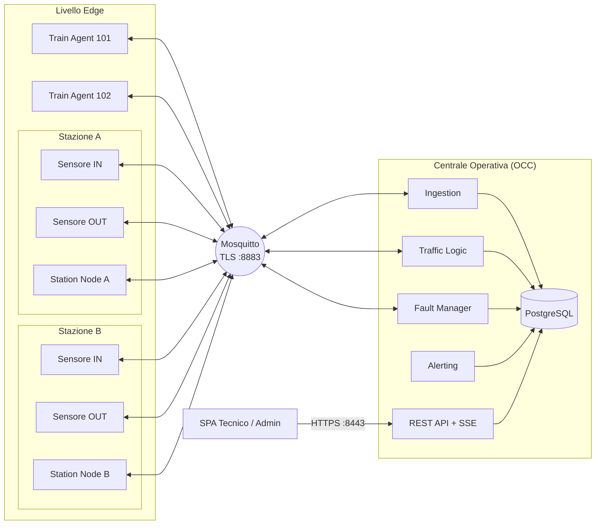
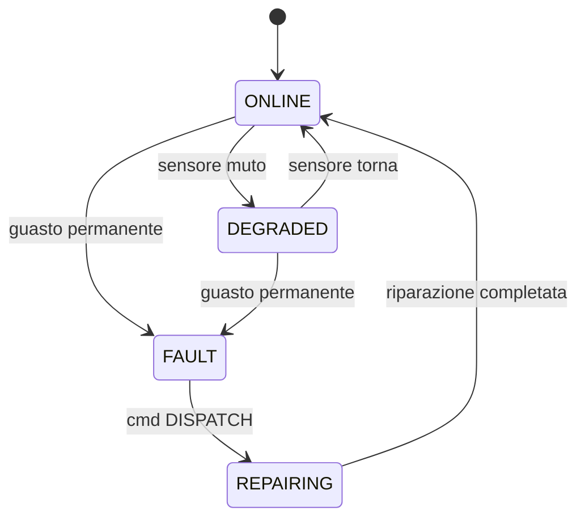
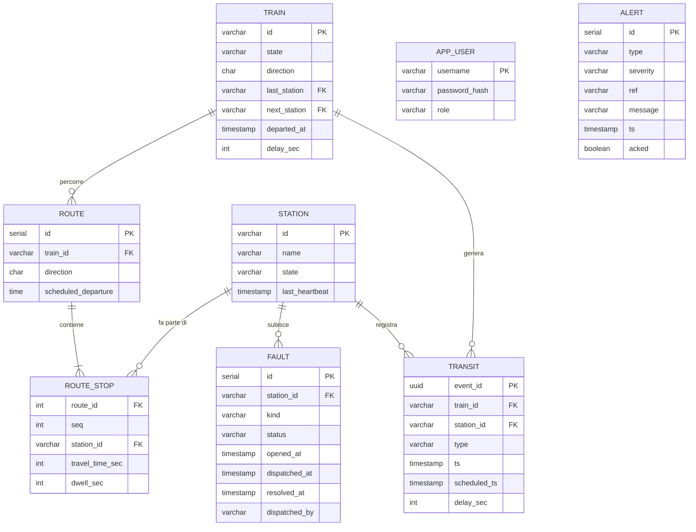
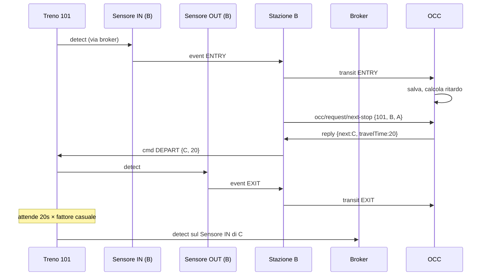
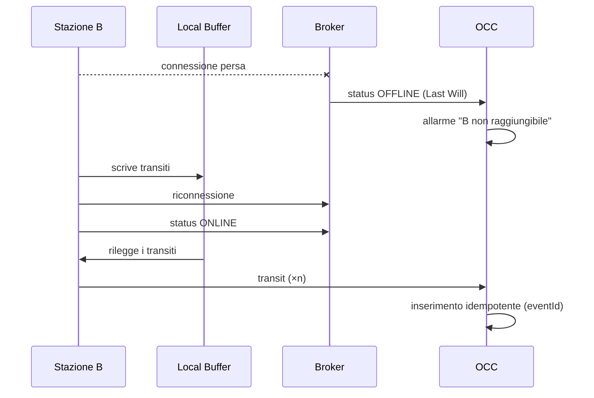
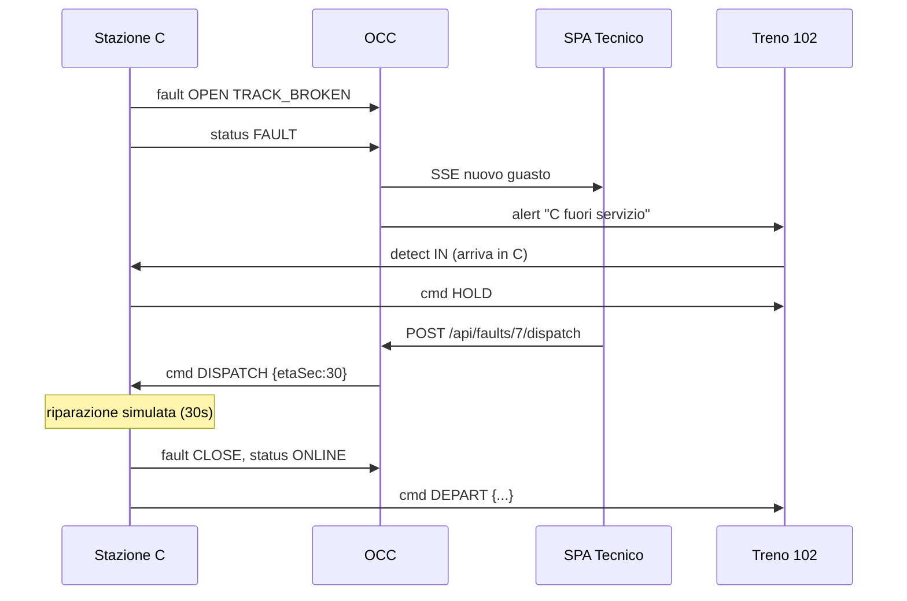
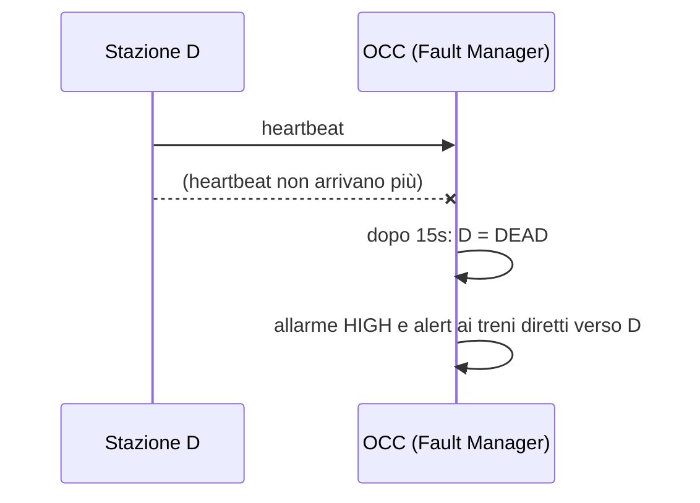

# Architettura – Sistema di Monitoraggio del Traffico Ferroviario

Documento di progetto. Copre le scelte tecnologiche, i servizi, i topic MQTT, il database, le API REST e i flussi principali. È pensato per servire da base ai capitoli 2–4 della relazione.

---

## 1. Scelte tecnologiche

| Ambito | Scelta | Perché |
|---|---|---|
| Linguaggio | **Java 21** | Il testo cita JDBC; è il linguaggio di riferimento del corso. Un solo linguaggio per tutti i servizi. |
| Build | **Maven** multi-modulo | Un modulo per servizio più un modulo `common` condiviso. |
| Client MQTT | **Eclipse Paho** (`org.eclipse.paho.client.mqttv3`) | Standard de facto in Java, supporta TLS, QoS, sessioni persistenti e Last Will. |
| Broker | **Mosquitto** | Leggero, configurazione TLS e ACL semplice. |
| REST + web server | **Javalin** | Micro-framework minimale. In alternativa **Spark Java**, se è quello visto a lezione. |
| JSON | **Jackson** | Serializzazione dei messaggi MQTT e delle risposte REST. |
| Database | **PostgreSQL** via JDBC | Variante 3: va bene anche SQLite o file JSON, senza penalità. |
| Password | **BCrypt** (jBCrypt) | Variante 2: login e password salvati sul server, senza penalità. |
| Interfaccia web | **SPA** in HTML + JavaScript (fetch e Server-Sent Events) | Variante 1: nessuna penalità. Senza framework, così ogni riga è facile da spiegare all'esame. |
| Deploy | **Docker Compose** per Mosquitto e Postgres; i servizi Java girano come processi separati | Si avvia con un solo comando al momento della demo. |

**Varianti scelte:** 1 (SPA), 2 (login/password) e 3 (JDBC). Nessuna è penalizzata. Il TLS va implementato, sia su MQTT sia su HTTPS. Ogni stazione è un processo separato.

---

## 2. Vista d'insieme



Nessun componente comunica direttamente con un altro: passa tutto dal broker tramite topic. L'unico canale fuori da MQTT è quello tra browser e OCC, in HTTPS.

### Processi in esecuzione durante la demo

| Processo | Quante istanze | Modulo Maven |
|---|---|---|
| `SensorAgent` | 2 per stazione (IN e OUT) | `sensor` |
| `StationNode` | 1 per stazione | `station` |
| `TrainAgent` | 1 per treno | `train` |
| `OccServer` | 1 | `occ` |
| Mosquitto, Postgres | 1 ciascuno | docker |

Uno script `launch.sh` avvia tutto partendo da un file `scenario.json` che elenca stazioni e treni.

---

## 3. I servizi

Per ogni servizio sono indicate le porte in ingresso (IN) e in uscita (OUT), cioè le facce dell'esagono, e i thread attivi.

### 3.1 SensorAgent

Simula un sensore fisico, per esempio una fotocellula o un lettore RFID. Ce n'è uno per l'ingresso e uno per l'uscita di ogni stazione.

- **IN:** `rail/station/{S}/sensor/{sensorId}/detect` è il "passaggio" simulato del treno.
- **OUT:** `rail/station/{S}/sensor/{sensorId}/event` è la rilevazione validata. `rail/station/{S}/sensor/{sensorId}/heartbeat` parte ogni 2 secondi.
- **Logica:** valida il messaggio (il treno esiste ed è nel formato giusto), aggiunge timestamp e un `eventId` (UUID) e lo inoltra alla stazione.
- **Simulazione guasto:** il comando `kill` sul topic `.../sim` ferma heartbeat e rilevazioni.
- **Thread:** callback di Paho e un `ScheduledExecutor` per l'heartbeat.

### 3.2 StationNode

È il cuore dell'edge, uno per stazione.

- **IN:**
  - `rail/station/{S}/sensor/+/event` – rilevazioni dei sensori
  - `rail/station/{S}/sensor/+/heartbeat` – battito dei sensori
  - `rail/station/{S}/reply/next-stop` – risposta della centrale sulla prossima fermata
  - `rail/station/{S}/cmd` – comandi dalla centrale (operatori inviati, guasto riparato, sopprimi treno)
  - `rail/station/{S}/sim` – iniezione di guasti per la demo
- **OUT:**
  - `rail/station/{S}/transit` – ingresso o uscita di un treno (QoS 1)
  - `rail/station/{S}/heartbeat` – ogni 5 secondi (QoS 0)
  - `rail/station/{S}/status` – `ONLINE`, `DEGRADED`, `FAULT` oppure `OFFLINE` (retained; `OFFLINE` è impostato come Last Will)
  - `rail/station/{S}/fault` – apertura o chiusura di un guasto (QoS 1)
  - `rail/occ/request/next-stop` – richiesta della prossima fermata
  - `rail/train/{id}/cmd` – ordini al treno (`DEPART`, `HOLD`, `SUPPRESS`)
- **Componenti interni:**
  - *Logic Controller:* tiene la mappa dei treni presenti e la macchina a stati della stazione.
  - *Local Buffer:* coda su file (`buffer-{S}.jsonl`) dei transiti non ancora confermati dal broker. Si svuota alla riconnessione.
  - *Heartbeat Generator* verso la centrale.
  - *Sensor Watchdog:* se un sensore tace per più di 3 heartbeat (6 secondi), la stazione passa a `DEGRADED`/`FAULT` e lo segnala alla centrale.
- **Thread:** callback di Paho, scheduler (heartbeat e watchdog), thread che svuota il buffer.

**Macchina a stati della stazione:**



Finché la stazione è in `FAULT` o `REPAIRING`, ogni treno che entra riceve `HOLD` e non riparte. Alla riparazione la stazione manda `DEPART` a tutti i treni trattenuti.

### 3.3 TrainAgent (digital twin)

Uno per treno. Lo stato interno contiene `trainId`, la direzione (A per andata, R per ritorno), la stazione precedente, la prossima stazione e uno stato tra `RUNNING`, `IN_STATION`, `HELD`, `SUPPRESSED` e `ARRIVED`.

- **IN:** `rail/train/{id}/cmd` (ordini della stazione) e `rail/train/{id}/alert` più `rail/alerts` (avvisi della centrale).
- **OUT:** `rail/station/{S}/sensor/{IN|OUT}/detect` (si presenta ai sensori) e `rail/train/{id}/telemetry` (posizione stimata ogni 5 secondi, opzionale).
- **Motore a eventi discreti:**
  1. Riceve `DEPART {next, travelTime}`.
  2. Pubblica `detect` sul sensore OUT della stazione attuale.
  3. Programma l'arrivo dopo `travelTime × fattore casuale` (per esempio 0.9–1.3, che simula rallentamenti).
  4. Allo scadere pubblica `detect` sul sensore IN della stazione `next` e attende nuovi ordini.
- **Simulazione:** il comando `sim stop` blocca il treno tra due stazioni, per far scattare l'allarme in centrale.
- **Thread:** callback di Paho e uno `ScheduledExecutor` per il motore.

### 3.4 OccServer (Centrale Operativa)

È un processo unico (monolite modulare), diviso in package con responsabilità separate. Il testo consente il monolite. In relazione ogni package si disegna come un esagono a sé.

| Modulo | IN | OUT | Compito |
|---|---|---|---|
| **Ingestion** | `rail/station/+/transit`, `rail/train/+/telemetry` | DB, EventBus interno | Valida il JSON, scarta i duplicati (`eventId` UNIQUE), aggiorna lo stato del treno, calcola il ritardo. |
| **Traffic Logic** | `rail/occ/request/next-stop` | `rail/station/{S}/reply/next-stop` | Legge la tratta dal DB e risponde con la prossima stazione e il tempo di percorrenza (o `END` al capolinea). |
| **Fault Manager** | `rail/station/+/heartbeat`, `+/status`, `+/fault` | `rail/station/{S}/cmd`, DB, EventBus | Watchdog sulle stazioni (timeout di 15 secondi oppure Last Will `OFFLINE`), apre e chiude gli incidenti, invia `DISPATCH`. |
| **Alerting** | EventBus, timer | `rail/alerts`, `rail/train/{id}/alert`, DB | Allarme "treno fermo tra stazioni", stazione morta, ritardo oltre soglia. Avvisa i treni diretti verso una stazione guasta. |
| **REST API** | HTTPS `/api/*` | DB, comandi al Fault Manager | Endpoint per la SPA e flusso SSE `/api/stream` per gli aggiornamenti in tempo reale. |
| **Persistence** | – | JDBC | DAO, uno per tabella. |

**Thread:** callback di Paho (che passa il lavoro a un executor per non bloccarsi), thread pool di Javalin, scheduler per i watchdog e per l'alerting. I moduli condividono un **EventBus** in memoria (semplice publish/subscribe con `ConcurrentLinkedQueue` e listener) e il pool di connessioni al DB.

---

## 4. Topic MQTT

Il prefisso è sempre `rail/`. Il payload è JSON con i campi comuni `ts` (ISO-8601) e, dove serve, `eventId`.

| Topic | Da → A | QoS | Retained | Esempio di payload |
|---|---|---|---|---|
| `station/{S}/sensor/{sid}/detect` | Treno → Sensore | 1 | no | `{"trainId":"101","ts":…}` |
| `station/{S}/sensor/{sid}/event` | Sensore → Stazione | 1 | no | `{"eventId":…,"sensor":"IN","trainId":"101","ts":…}` |
| `station/{S}/sensor/{sid}/heartbeat` | Sensore → Stazione | 0 | no | `{"ts":…}` |
| `station/{S}/transit` | Stazione → OCC | 1 | no | `{"eventId":…,"trainId":"101","type":"ENTRY","dir":"A","ts":…}` |
| `station/{S}/heartbeat` | Stazione → OCC | 0 | no | `{"ts":…,"sensors":{"IN":"OK","OUT":"OK"}}` |
| `station/{S}/status` | Stazione → OCC | 1 | **sì** (Last Will = `OFFLINE`) | `{"state":"ONLINE"}` |
| `station/{S}/fault` | Stazione → OCC | 1 | no | `{"faultId":…,"kind":"TRACK_BROKEN","action":"OPEN"}` |
| `occ/request/next-stop` | Stazione → OCC | 1 | no | `{"reqId":…,"stationId":"B","trainId":"101","dir":"A"}` |
| `station/{S}/reply/next-stop` | OCC → Stazione | 1 | no | `{"reqId":…,"next":"C","travelTime":20}` oppure `{"next":null}` |
| `station/{S}/cmd` | OCC → Stazione | 1 | no | `{"cmd":"DISPATCH","faultId":…,"etaSec":30}` / `{"cmd":"SUPPRESS","trainId":"101"}` |
| `station/{S}/sim` | Demo → Stazione | 1 | no | `{"inject":"TRACK_BROKEN"}` |
| `train/{id}/cmd` | Stazione → Treno | 1 | no | `{"cmd":"DEPART","next":"C","travelTime":20}` / `{"cmd":"HOLD","reason":…}` |
| `train/{id}/alert` | OCC → Treno | 1 | no | `{"type":"DELAY","msg":…}` |
| `train/{id}/telemetry` | Treno → OCC | 0 | no | `{"from":"B","to":"C","progress":0.4}` |
| `alerts` | OCC → tutti | 1 | no | `{"severity":"HIGH","msg":"Stazione C fuori servizio"}` |

**Sicurezza del broker:** Mosquitto ascolta solo sulla porta 8883 in TLS, con una CA del progetto. Ogni servizio si autentica con username e password. Le ACL limitano i topic: per esempio `station-B` può scrivere solo sotto `rail/station/B/#`, `rail/occ/request/#` e `rail/train/+/cmd`.

---

## 5. Affidabilità

| Problema | Soluzione |
|---|---|
| La stazione perde la connessione con il broker | Sessione persistente (`cleanSession=false`) con QoS 1 e Local Buffer su file come seconda rete di sicurezza: i transiti vengono scritti nel buffer e rimossi solo dopo il `deliveryComplete` di Paho. |
| Messaggi duplicati (QoS 1 = almeno una volta) | `eventId` UNIQUE nel DB: l'inserimento usa `ON CONFLICT DO NOTHING`, quindi è idempotente. |
| Stazione morta (fail-stop) | Doppia rilevazione: il **Last Will** fa arrivare `OFFLINE` subito se cade la connessione TCP; il **timeout heartbeat** (3 battiti mancati) copre il caso in cui il processo è bloccato ma ancora connesso. |
| Sensore morto | Watchdog della stazione, che passa a `DEGRADED` e lo comunica sullo `status`. |
| Treno fermo tra due stazioni | L'Alerting controlla ogni 5 secondi: se `now > partenza + travelTime × 1.5` e non è arrivato l'`ENTRY`, scatta un allarme. |
| Riavvio della centrale | Lo stato è nel DB. Gli `status` retained ricostruiscono subito la mappa delle stazioni. |

---

## 6. Database



- **Orario previsto:** `scheduled_ts` di una fermata = `scheduled_departure` + somma di (`travel_time` + `dwell`) delle fermate precedenti.
- **Ritardo:** `delay = ts_reale − scheduled_ts`.
- **Previsione di arrivo (ETA)** alla prossima stazione = `departed_at + travel_time + delay` attuale.

---

## 7. API REST (OCC)

Si accede in HTTPS. L'autenticazione usa una sessione con cookie dopo il login; i ruoli sono `TECH` e `ADMIN`.

| Metodo | Percorso | Ruolo | Descrizione |
|---|---|---|---|
| POST | `/api/login`, `/api/logout` | – | Autenticazione |
| GET | `/api/stations` | TECH, ADMIN | Stato di tutte le stazioni |
| GET | `/api/stations/{id}/expected` | TECH, ADMIN | Treni attesi in ingresso e in uscita, con ETA |
| GET | `/api/trains`, `/api/trains/{id}` | TECH, ADMIN | Posizione, stato, ritardo |
| GET | `/api/routes`, `/api/routes/{id}` | TECH, ADMIN | Tratte con le fermate |
| POST / PUT / DELETE | `/api/routes[/{id}]` | ADMIN | Crea, modifica o elimina una tratta (o le sue fermate) |
| POST | `/api/trains/{id}/suppress` | ADMIN | Sopprime un treno fermo in stazione |
| GET | `/api/faults?status=OPEN` | TECH, ADMIN | Guasti aperti |
| POST | `/api/faults/{id}/dispatch` | TECH | Invia gli operatori |
| GET | `/api/alerts`, POST `/api/alerts/{id}/ack` | TECH, ADMIN | Allarmi |
| GET | `/api/stream` | TECH, ADMIN | Server-Sent Events con i cambi di stato in tempo reale |

**SPA:** contiene una dashboard con la mappa della linea (stazioni colorate per stato e treni posizionati), la tabella dei treni con il ritardo, il pannello dei guasti con il pulsante "Invia operatori" (per il tecnico), il pannello degli allarmi e l'editor delle tratte (per l'admin).

---

## 8. Flussi principali (diagrammi di sequenza)

### 8.1 Transito normale con richiesta della prossima fermata



### 8.2 Disconnessione temporanea della stazione



### 8.3 Guasto permanente e riparazione



### 8.4 Stazione morta senza disconnessione (processo bloccato)



---

## 9. Struttura del repository

```
PissirShared/
├── pom.xml                 (parent)
├── common/                 messaggi (record Java), costanti dei topic, MqttHelper con TLS
├── sensor/                 SensorAgent
├── station/                StationNode, LocalBuffer, SensorWatchdog
├── train/                  TrainAgent, DiscreteEventEngine
├── occ/                    OccServer, ingestion/, traffic/, fault/, alerting/, api/, db/
│   └── src/main/resources/public/   SPA (index.html, app.js, style.css)
├── infra/
│   ├── docker-compose.yml  mosquitto + postgres
│   ├── mosquitto/          mosquitto.conf, acl, passwd
│   ├── certs/              script per generare CA e certificati
│   └── db/schema.sql, seed.sql
├── scenario.json           stazioni, treni, tratte per la demo
├── launch.sh
└── docs/
```

---

## 10. Piano di lavoro suggerito

1. **Infrastruttura:** docker-compose, Mosquitto (prima senza TLS), schema del DB, modulo `common`.
2. **Percorso minimo:** sensore, stazione e treno su una linea A–B–C con tratte fisse. Verificare i messaggi con `mosquitto_sub -t 'rail/#' -v`.
3. **OCC:** ingestion e traffic logic (next-stop) con persistenza.
4. **Affidabilità:** heartbeat, watchdog, Last Will, local buffer, deduplicazione.
5. **Guasti:** iniezione, HOLD, dispatch, ripristino.
6. **REST e SPA:** login, dashboard, SSE, editor delle tratte.
7. **TLS** su Mosquitto e HTTPS, ACL.
8. **Validazione:** test unitari (calcolo dei ritardi, deduplicazione, macchina a stati) e scenari di demo scritti, uno per ogni diagramma della sezione 8.

## 11. Collegamento con la relazione

| Capitolo della relazione | Sezioni di questo documento |
|---|---|
| 1. Specifiche funzionali | Testo del progetto e §3 (compiti dei servizi) |
| 2. Analisi delle tecnologie | §1, alternative (REST polling vs MQTT, WebSocket, AMQP/RabbitMQ, CoAP) |
| 3. Scelta dell'approccio | Perché un broker: disaccoppiamento, NAT traversal (solo connessioni in uscita dalle reti private), QoS, Last Will |
| 4. Architettura | §2, §3 (esagoni), §4, §8 |
| 5. Implementazione | §6, §7, diagrammi UML delle classi da produrre a codice scritto |
| 6. Validazione | §10 punto 8 |
