# Sistema di monitoraggio e gestione del traffico ferroviario

Relazione finale del progetto PISSIR, anno accademico 2025/26.

> Bozza. Va riletta, completata con i nomi del gruppo e riscritta dove serve con parole nostre.

## 1. Specifiche funzionali

Il sistema controlla il traffico di una rete ferroviaria. Le stazioni rilevano il passaggio dei treni con dei sensori e mandano i dati a una centrale operativa, che li raccoglie, calcola ritardi e arrivi previsti e mostra la situazione a tecnici e amministratori attraverso un'interfaccia web.

Le funzioni si dividono in due gruppi, come indicato nello schema della relazione.

### 1.1 Controllo locale con sensori e attuatori

- Ogni stazione ha un sensore di ingresso e uno di uscita, che rilevano il passaggio di un treno e il suo numero di convoglio.
- Un treno può uscire da una stazione senza esserci entrato (stazione di partenza) o entrarci senza uscirne (capolinea).
- La stazione decide quando il treno riparte e verso quale stazione, in base alla tratta del treno.
- La stazione controlla i propri sensori: se uno smette di funzionare, lo segnala alla centrale.
- In caso di guasto permanente (binario rotto, treno deragliato) la stazione lo segnala subito alla centrale e ferma ogni treno che arriva, finché gli operatori non hanno riparato il guasto.
- Ogni treno è un processo indipendente che simula il proprio viaggio e riceve avvisi su guasti e ritardi.

### 1.2 Accesso via Internet

- Stazioni e treni si trovano in reti private e devono funzionare senza configurare gli apparati di rete.
- La centrale deve essere raggiungibile allo stesso modo dalla rete interna e da quella pubblica.
- La centrale memorizza lo stato della linea, lo storico dei transiti, i guasti e le tratte di andata e ritorno di ogni treno.
- Se una stazione smette di comunicare, la centrale la considera guasta. Se un treno resta fermo troppo a lungo tra due stazioni, la centrale genera un allarme.
- I dati dei transiti non devono andare persi, nemmeno durante una disconnessione temporanea.
- Il tecnico vede il traffico, le tratte e i treni attesi in ogni stazione, e invia gli operatori a riparare le stazioni guaste.
- L'amministratore vede il traffico e le tratte, può aggiungere, modificare ed eliminare tratte e sopprimere i treni fermi in stazione.
- Tutte le comunicazioni passano su TLS.

## 2. Analisi della tecnologia

### 2.1 Sensori

Per rilevare un treno si possono usare lettori RFID, sensori di pressione sui binari o fotocellule. Per la logica di controllo la scelta conta poco: in tutti i casi il sensore produce un evento "passaggio del treno N" che la stazione deve gestire. Nel nostro progetto i sensori sono simulati da processi che ricevono un messaggio dal treno e lo inoltrano alla stazione, e quindi si potrebbero sostituire con dispositivi veri senza toccare il resto del sistema.

### 2.2 Vincoli di rete

I vincoli più forti riguardano la rete. Le stazioni stanno in reti private, dietro un router con NAT, e non possiamo chiedere di aprire porte o di avere un indirizzo pubblico. Ne segue che una stazione non può fare da server: deve essere lei ad aprire la connessione verso l'esterno. La centrale, invece, può avere un indirizzo pubblico, ed è l'unico punto che deve essere raggiungibile.

Abbiamo considerato queste soluzioni:

| Soluzione | Vantaggi | Problemi |
|---|---|---|
| Server REST in ogni stazione, interrogato dalla centrale | Semplice da capire | La centrale deve raggiungere le stazioni: servono port forwarding o indirizzi pubblici, che il vincolo esclude |
| Stazioni che chiamano le API REST della centrale (polling) | Funziona dietro NAT | La centrale non può mandare comandi alle stazioni o ai treni se non quando la interrogano; per avere tempi brevi bisogna interrogarla spesso, con molto traffico inutile |
| WebSocket tra stazioni e centrale | Connessione aperta in uscita dalla stazione, comunicazione nei due sensi | Recapito affidabile, riconnessione e smistamento dei messaggi vanno scritti da zero |
| CoAP | Pensato per dispositivi con poche risorse, messaggi piccoli | Usa UDP, che attraverso il NAT si comporta peggio; meno adatto a collegare reti diverse |
| Message broker (MQTT o AMQP) | Tutti aprono una connessione in uscita verso il broker; comunicazione nei due sensi; QoS, sessioni persistenti e Last Will già nel protocollo | Il broker è un componente in più da gestire e diventa un punto critico |
| VPN tra stazioni e centrale | Le stazioni diventano raggiungibili come in una rete locale | Richiede di configurare ogni sito, contro il vincolo |

### 2.3 Caratteristiche del traffico

I messaggi sono piccoli, poche centinaia di byte in JSON. Ogni stazione ne produce pochi: alcuni per ogni treno che passa (rilevazioni, transiti, richiesta della prossima fermata) e un heartbeat ogni 5 secondi. Anche con molte stazioni il traffico totale resta basso.

Non ci sono vincoli di tempo reale stretti: un aggiornamento che arriva in centrale dopo qualche centinaio di millisecondi va benissimo. Conta di più che i transiti non vadano persi, perché da loro dipendono posizione e ritardo dei treni. Gli heartbeat invece si possono perdere: ne arriva un altro dopo pochi secondi.

## 3. Scelta dell'approccio

La scelta principale, indicata dal docente, è usare un message broker. Abbiamo usato MQTT con il broker Mosquitto.

I vantaggi che abbiamo trovato, rispetto alle alternative del capitolo precedente:

- Funziona dietro NAT senza configurare nulla. Stazioni, sensori, treni e centrale aprono tutti una connessione in uscita verso il broker; nessuno deve essere raggiungibile dall'esterno, tranne il broker stesso.
- I componenti sono disaccoppiati. Una stazione non sa dove si trovi la centrale né quante istanze ci siano: pubblica su un topic e il broker consegna il messaggio a chi è iscritto. Aggiungere una stazione significa avviare un processo con un nome nuovo, senza toccare gli altri.
- Il recapito affidabile c'è già. Con QoS 1 il broker conferma ogni messaggio, e con la sessione persistente conserva i messaggi per un client disconnesso finché non torna. Per questo non abbiamo scritto una cache locale nelle stazioni.
- Il Last Will permette alla centrale di sapere subito quando una stazione cade, senza aspettare che scada un timeout.
- I messaggi retained fanno sì che la centrale, appena si connette, conosca l'ultimo stato di ogni stazione.
- Il broker gestisce autenticazione e permessi sui topic, quindi possiamo limitare cosa può pubblicare ogni tipo di client.

Lo svantaggio principale è che il broker diventa un punto critico: se si ferma, si ferma tutta la comunicazione. In un sistema reale si userebbe un cluster di broker; per il progetto ne basta uno.

Rispetto ai sistemi multimediali visti a lezione la priorità è diversa. In uno streaming audio o video un pacchetto in ritardo è inutile e conviene perderlo, per questo si usano protocolli su UDP che non ritrasmettono. Nel nostro caso un transito che arriva con un secondo di ritardo è ancora utile, mentre uno perso falsa la posizione del treno: per questo usiamo un protocollo su TCP con conferma dei messaggi.

Abbiamo scelto Mosquitto invece di RabbitMQ perché parla MQTT in modo nativo, è leggero e si configura con un solo file. RabbitMQ supporta MQTT tramite un plugin ma è pensato soprattutto per AMQP, con funzioni (code, exchange, routing complesso) che a noi non servono.

Per l'accesso degli utenti la centrale offre API REST in HTTPS, usate da una pagina web.

## 4. Architettura del software

### 4.1 Vista d'insieme

Il sistema ha tre livelli: l'edge (sensori, stazioni e treni), il broker MQTT e la centrale operativa con il suo database e l'interfaccia web.

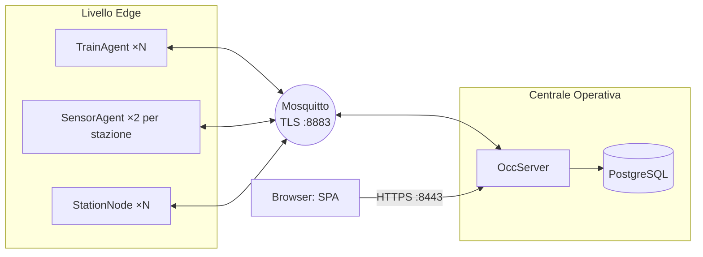

Ogni sensore, stazione e treno è un processo separato. I componenti non si parlano mai direttamente: tutto passa dal broker attraverso topic, il cui elenco completo è nella sezione 4 di [architettura.md](architettura.md).

### 4.2 Servizi

Per ogni servizio indichiamo le interfacce di ingresso (a sinistra) e di uscita (a destra) e le funzioni della sua logica.

#### SensorAgent

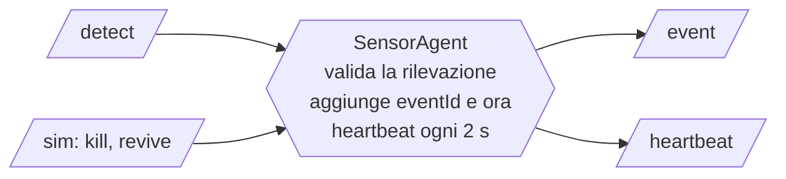

#### StationNode

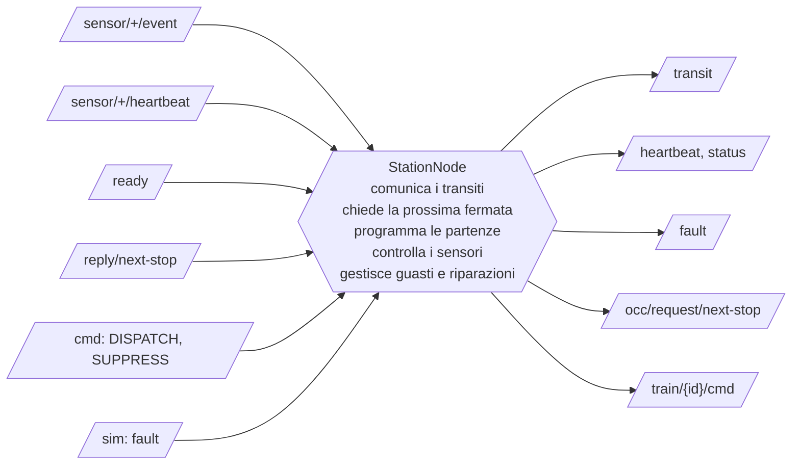

#### TrainAgent

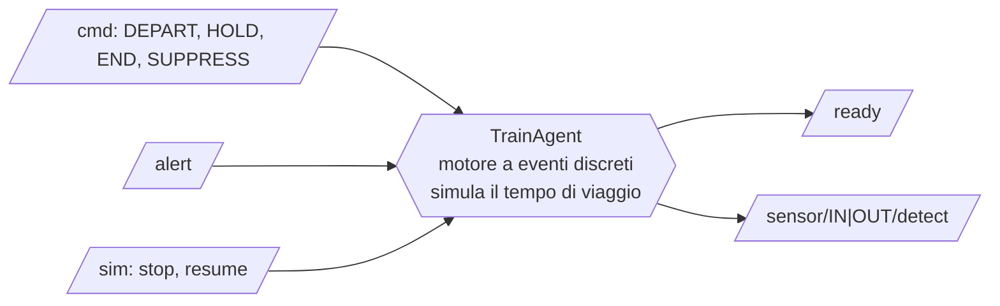

#### Centrale operativa

La centrale è un unico processo diviso in moduli. Disegniamo un esagono per ogni modulo che ha interfacce verso l'esterno.

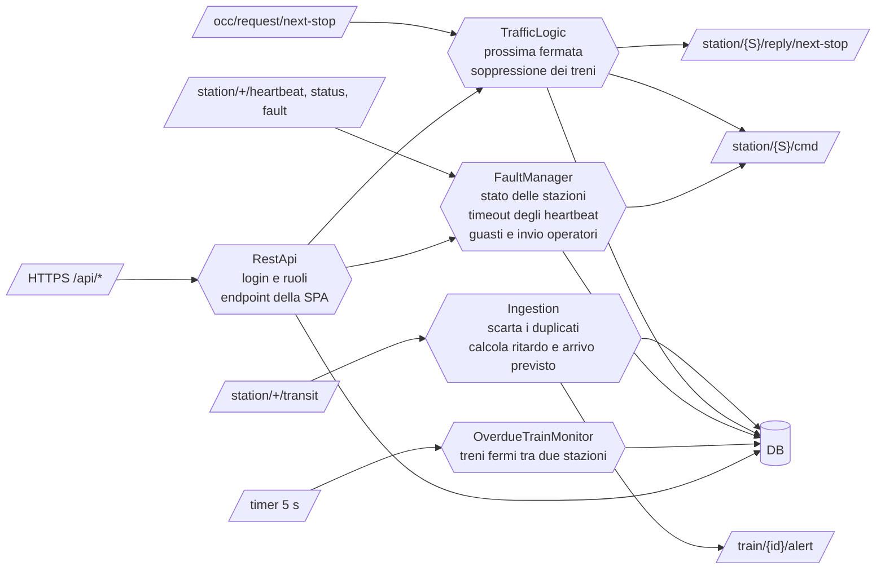

### 4.3 Attività e condivisione

Ogni processo ha pochi thread:

- un thread che gestisce i messaggi MQTT ricevuti, uno alla volta e nell'ordine di arrivo (classe `Mqtt`), così la callback della libreria Paho non resta mai bloccata;
- uno scheduler per le attività periodiche o ritardate: heartbeat, controllo dei sensori, partenze dopo la sosta, fine della riparazione, arrivo del treno;
- nella centrale, anche il pool di thread di Javalin per le richieste HTTP.

I processi non condividono memoria: comunicano solo con messaggi MQTT. Dentro la centrale i moduli si chiamano direttamente e condividono il database, che contiene lo stato dei treni, delle stazioni e dei guasti. Le poche informazioni tenute in memoria e lette da più thread (ad esempio l'ultimo heartbeat di ogni sensore o i treni fermi per un guasto) sono in mappe concorrenti.

### 4.4 Protocolli di comunicazione

#### Transito di un treno

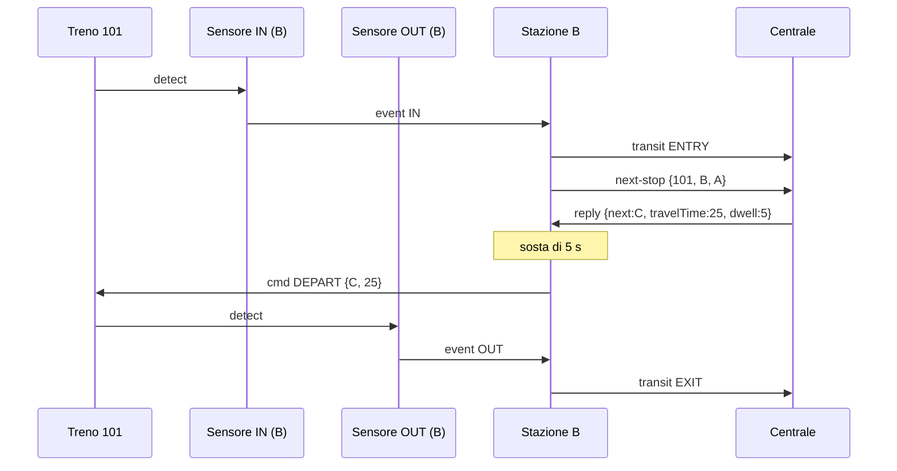

La stazione chiede la prossima fermata alla centrale a ogni ingresso. Così, se l'amministratore modifica una tratta, il cambiamento vale già dalla fermata successiva.

#### Guasto permanente

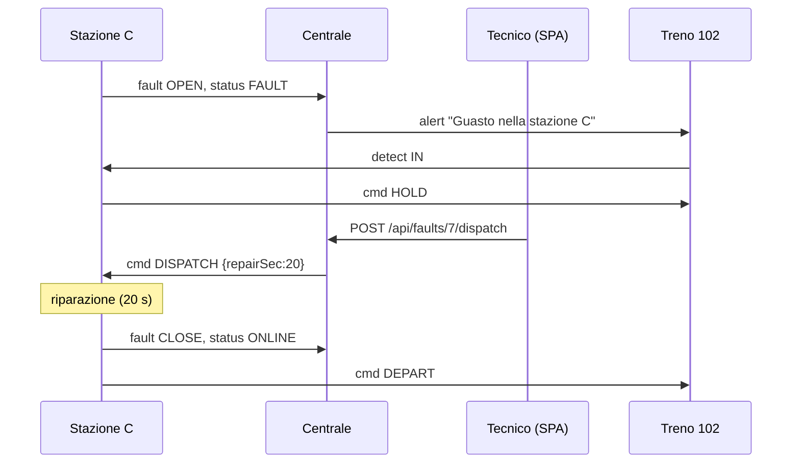

#### Stazione caduta o bloccata

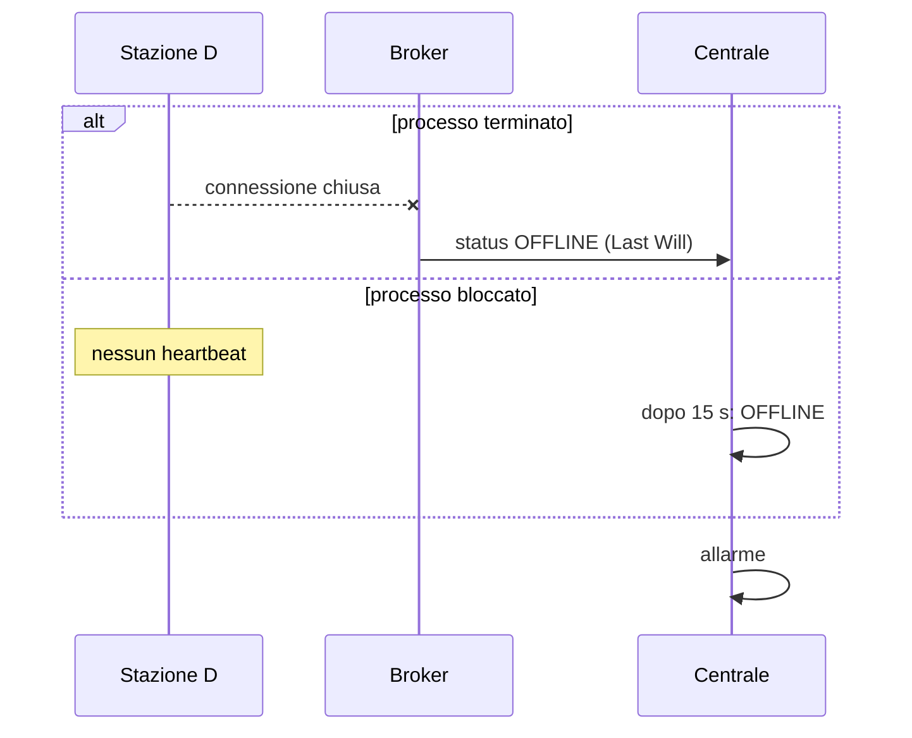

#### Centrale non raggiungibile

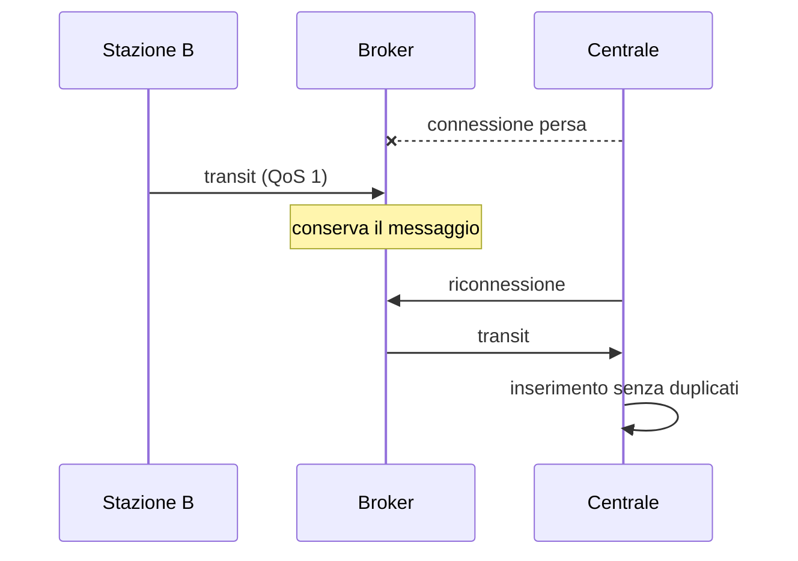

### 4.5 Sicurezza

Mosquitto accetta solo connessioni TLS sulla porta 8883, con un certificato firmato da una CA creata per il progetto. Ogni client si autentica con utente e password, e un file ACL stabilisce su quali topic può leggere e scrivere. La centrale offre le API solo in HTTPS, sulla porta 8443. Le password degli utenti web sono salvate con BCrypt; dopo il login il server crea una sessione nuova e controlla il ruolo a ogni richiesta.

## 5. Descrizione dell'implementazione

Il progetto è in Java 21, organizzato con Maven in cinque moduli: `common`, `sensor`, `station`, `train` e `occ`.

### 5.1 Modulo common

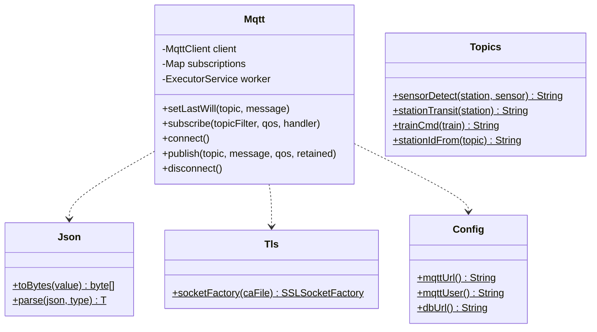

`Mqtt` avvolge il client Paho. Converte i messaggi in JSON, rinnova le sottoscrizioni a ogni connessione e gestisce i messaggi ricevuti su un thread dedicato. Le sottoscrizioni vanno registrate prima della connessione, perché con la sessione persistente il broker consegna i messaggi in coda subito dopo il collegamento. `Topics` raccoglie i nomi dei topic, `Json` la conversione dei messaggi, `Tls` la creazione della connessione sicura. I messaggi sono record Java nel package `msg` (`Transit`, `StationStatus`, `TrainCommand` e gli altri).

### 5.2 Sensore, stazione e treno

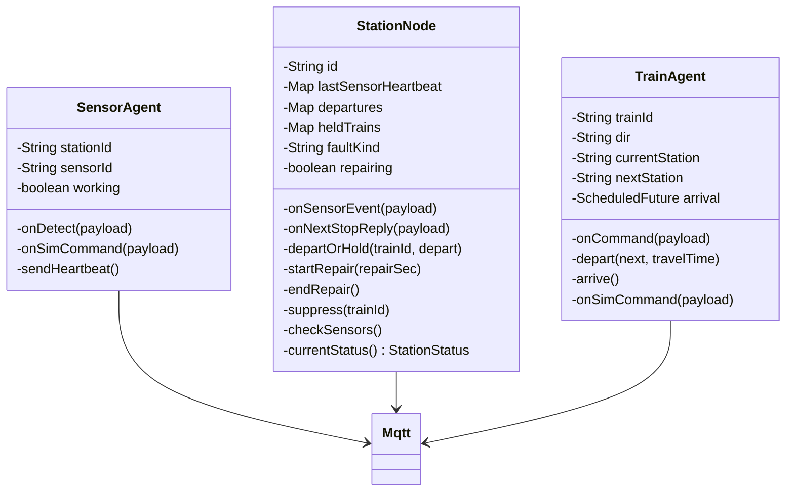

Lo stato della stazione si ricava da tre informazioni: se c'è un guasto in corso (`faultKind`), se gli operatori stanno riparando (`repairing`) e quali sensori non rispondono. Il metodo `currentStatus()` le combina nello stato pubblicato verso la centrale. La partenza di ogni treno è programmata dopo la sosta; al momento della partenza `departOrHold()` controlla se c'è un guasto e, in quel caso, ferma il treno e lo mette nell'elenco `heldTrains`.

Il treno tiene l'arrivo programmato in `arrival`. Il comando di simulazione `stop` lo annulla, lasciando il treno fermo tra due stazioni.

### 5.3 Centrale operativa

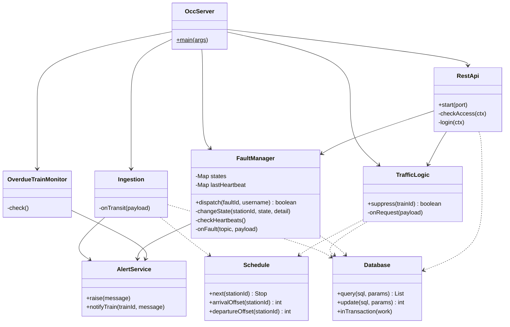

`Schedule` contiene le fermate di una tratta e calcola gli orari previsti a partire dalla partenza dalla stazione di origine. La usano sia `TrafficLogic`, per la prossima fermata, sia `Ingestion`, per il ritardo. Non dipende dal database, quindi l'abbiamo potuta verificare con test automatici.

L'accesso al database passa da `Database`, che esegue query con JDBC, e da un DAO per tabella (`TrainDao`, `StationDao`, `RouteDao`, `FaultDao`, `AlertDao`, `UserDao`). La creazione e la modifica di una tratta usano una transazione, così una tratta non resta mai a metà.

`RestApi` definisce gli endpoint con Javalin. Ogni endpoint dichiara i ruoli ammessi, e il metodo `checkAccess()` li verifica prima di eseguirlo.

### 5.4 Interfaccia utente

L'interfaccia è una single page application in HTML e JavaScript, senza framework. Dopo il login mostra una sotto l'altra le tabelle di:

- allarmi, con ora e messaggio;
- guasti non ancora riparati, con stazione, tipo, stato e chi ha inviato gli operatori;
- stazioni, con stato, dettaglio (ad esempio "Sensori non raggiungibili: IN") e ultimo heartbeat; un bottone mostra i treni in arrivo e quelli in stazione;
- treni, con stato, direzione, ultima e prossima stazione, arrivo previsto e ritardo;
- tratte, con le fermate in ordine.

Le tabelle vengono rilette ogni 2 secondi. Il tecnico ha il bottone "Invia operatori" sui guasti da riparare. L'amministratore ha il bottone "Sopprimi" sui treni fermi in stazione, i bottoni per modificare ed eliminare le tratte e un modulo per crearne di nuove, dove le fermate si scrivono una per riga (stazione, secondi di viaggio, secondi di sosta).

## 6. Validazione

Abbiamo verificato il sistema con test automatici e con scenari di prova sul sistema completo. Il dettaglio, con i comandi per ripetere ogni prova e i risultati osservati, è in [validazione.md](validazione.md).

I test automatici (`mvn test`) controllano il calcolo degli orari previsti, la conversione dei messaggi in JSON e la corrispondenza tra topic e filtri delle sottoscrizioni.

Gli scenari sul sistema completo sono:

| Scenario | Esito |
|---|---|
| Viaggio normale, con ritardi e arrivi previsti | superato |
| Guasto permanente, treni fermati, invio degli operatori e ripartenza | superato |
| Sensore guasto, segnalato dalla stazione alla centrale | superato |
| Treno fermo tra due stazioni, segnalato dalla centrale | superato |
| Stazione caduta (Last Will) o bloccata (timeout degli heartbeat) | superato |
| Centrale spenta durante il viaggio, nessun transito perso | superato |
| Soppressione di un treno fermo in stazione | superato |
| Creazione, modifica ed eliminazione delle tratte, con controllo dei dati | superato |
| Accesso senza login, password errate, connessioni senza TLS, permessi sui topic | superato |

Per simulare i guasti durante la demo usiamo lo script `sim.sh`, che pubblica i comandi di simulazione sul broker.
